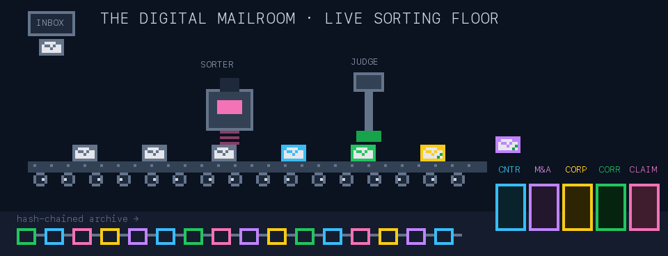

<div align="center">


<br/>

[](https://www.python.org/)
[](https://docs.astral.sh/uv/)
[](packages/llm-mailroom)
[](CHANGELOG.md)
[](LICENSE)

[](https://digital-mailroom-theta.vercel.app)
[](https://huggingface.co/datasets/Lucius-Morningstar/mailroom-dataset)
[](https://github.com/LLM-Mailroom-Services/Digital-Mailroom/wiki)

**[Quickstart](#-quickstart)** · **[How it works](#-a-day-in-the-life-of-a-document)** · **[The constellation](#-the-constellation)** · **[House rules](#-house-rules)** · **[Docs](#-where-to-go-next)**

</div>

---

## 📬 What is this?

Picture a law firm's mailroom. Letters arrive. Someone **sorts** them,
someone **reads** them and pulls out the facts, a supervisor **checks the
work**, and every envelope ends up **filed with a receipt**. Nothing gets
lost and nobody gets to guess.

Digital Mailroom does the same job with AI agents. It is the **integration
hub** for the LLM-Mailroom constellation: one checkout that wires together a
multi-agent legal-document pipeline, a deterministic scoring dojo, a pixel-art
visualizer, an offline/GPU sandbox and corpus EDA. It uses **one uv workspace,
one lockfile and one virtualenv**, and no package imports another repo
outside the workspace.

<div align="center">

</div>

## 🏭 A day in the life of a document

<div align="center">

<br/><sub><i>Live from the sorting floor. Rendered by <code>docs/assets/readme/make_sorting_gif.py</code>.</i></sub>
</div>

<br/>

| | Stage | What happens |
| :---: | :--- | :--- |
| 📥 | **Ingest** | One fused triage + clean + prepare pass turns a raw file into a claimed, normalized manifest |
| 🏷️ | **Classify** | The `SorterAgent` assigns one of five live classes (`contract` · `merger_agreement` · `corporate_record` · `correspondence` · `insurance_claim`) with a confidence. High confidence goes to extract, medium retries, and low or unknown goes to a human |
| 🔍 | **Extract** | A class specialist produces structured Pydantic output, gated on schema, confidence, factuality and completeness |
| ⚖️ | **Judge → Arbiter** | Ambiguous completeness gets a second opinion. Matter conflicts go to the **Boss**, which never resolves them silently by recency |
| 🧑‍⚖️ | **Human review** | The governance boundary: approve, correct, reconcile or reject. Corrections resume from the corrected state |
| 🗂️ | **Compile → Catalog → Archive** | Deterministic matter-record assembly (no LLM call), persistence, and a hash-chained audit archive |

> The full map is [`docs/assets/mailroom-pipeline.svg`](docs/assets/mailroom-pipeline.svg). Terminology is in the [v7 taxonomy spec](docs/v7-taxonomy.md). Both are the root-level sources of truth.

<details>
<summary><b>🖼️ The classic six-stage processing banner</b></summary>
<br/>
<picture>
  <source media="(prefers-color-scheme: dark)" srcset="docs/assets/mailroom-processing-banner-dark.svg">
  
</picture>
</details>

## 🌌 The constellation

<div align="center">

</div>

Five core packages live in `packages/` as git subtrees imported from their
authoritative standalone `Exios66/*` repositories. Four are built members and
one is a virtual corpus-EDA member.

| | Package | Role | Source | Site |
| :---: | :--- | :--- | :--- | :--- |
| 🥋 | `llm-dojo-scoring` | **All** scoring engine logic and metrics, plus the error-analysis and interpretation suite | [`Exios66/llm-dojo-scoring`](https://github.com/Exios66/llm-dojo-scoring) | — |
| 🧠 | `llm-mailroom` | LangGraph multi-agent legal-document pipeline (FastAPI producer) | [`Exios66/llm-mailroom`](https://github.com/Exios66/llm-mailroom) | — |
| 👾 | `The-Mailroom` | Shared pixel-art visualizer for **both** the pipeline and the sandbox, plus the hosted Observatory | [`Exios66/The-Mailroom`](https://github.com/Exios66/The-Mailroom) | [🌐 Pages](https://exios66.github.io/The-Mailroom/) |
| 🧪 | `local-mailroom-sandbox` | Core offline/local and Modal/vLLM GPU testing interface for the pipeline | [`Exios66/local-mailroom-sandbox`](https://github.com/Exios66/local-mailroom-sandbox) | — |
| 📊 | `mailroom-corpus-eda` | Corpus EDA (P0–P6) and the centralized HF upload helpers | [`Exios66/Mailroom-Corpus-EDA`](https://github.com/Exios66/Mailroom-Corpus-EDA) | [🌐 Pages](https://exios66.github.io/Mailroom-Corpus-EDA/) |

The hub itself is [`LLM-Mailroom-Services/Digital-Mailroom`](https://github.com/LLM-Mailroom-Services/Digital-Mailroom). It hosts the live [📋 Dispatch Board](https://digital-mailroom-theta.vercel.app).

> [!NOTE]
> `mailroom-corpus-eda` is the only virtual member (`package = false`). It has no build system and is not installed, and its EDA code and deliverables stay colocated with the four built members.

<details>
<summary><b>🧭 Plain-text architecture map</b> (for terminals and screen readers)</summary>

```text
 Enron-Evaluation-Environment ─┐  (external corpus feeds)
 claims-data-eda ──────────────┴─> mailroom-corpus-eda
                                   EDA + centralized HF upload helpers
                                              │ publishes
                                              ▼
                                   HF Hub: mailroom-dataset (pinned tag)
                          ┌───────────────────┴───────────────────┐
                          │ pinned pull                           │ pinned pull
                          ▼                                       ▼
 ┌─────────────────────────────┐ executes ┌─────────────────────────────┐
 │ local-mailroom-sandbox      │ ───────> │ llm-mailroom                │
 │ offline/local + Modal/vLLM  │          │ 13-node LangGraph pipeline  │
 │ GPU testing harness         │          │ (FastAPI producer)          │
 └──────────────┬──────────────┘          └──────────────┬──────────────┘
                │ scores with                            │ scores with
                └───────────────────┐  ┌─────────────────┘
                                    ▼  ▼
                     ┌───────────────────────────────┐
                     │ llm-dojo-scoring              │
                     │ ALL scoring engine + metrics  │
                     └───────────────────────────────┘

 llm-mailroom ───────────┐
 local-mailroom-sandbox ─┴─ traces / API ─> Langfuse ─> The-Mailroom
                                                       shared visualizer, both

 Standalone sources ─── sync_packages.py pull ──> Digital-Mailroom packages/
 Imported packages ──── sync_vendor.py ─────────> sandbox vendor snapshots
 Digital-Mailroom owns hub wiring, governance, board, integration tooling.
```

</details>

<details>
<summary><b>🪦 Alumni and external feeds</b> (pruned packages and preserved checkouts)</summary>
<br/>

**Pruned in DMR-079.** `llm-entity-extraction` and `llm-mailroom-graph` left
the monorepo. They exist only as standalone `Exios66/*` repos and are no
longer synced. `agent-mailroom` is preserved on the branch
`feature/agent-mailroom`. Hub `v0.8.0` is the last release containing them
and serves as the rollback point.

**External corpus feeds.** Enron and claims remain usable standalone feeds,
and their datasets, taxonomy and published sites keep their identities.
DMR-093 (PR #167, merged 2026-10-23) removed their local copies from the
active workspace. Both preservation branches point to
`59c879d9fb4480084e53137e2e9fb25650933944`, the last commit that carried the
complete package trees.

| Layer | Repository | GitHub Pages |
| --- | --- | --- |
| **Corpus feed** | [`Exios66/Enron-Evaluation-Environment`](https://github.com/Exios66/Enron-Evaluation-Environment) | [exios66.github.io/Enron-Evaluation-Environment](https://exios66.github.io/Enron-Evaluation-Environment/) |
| **Corpus feed** | [`Exios66/claims-data-eda`](https://github.com/Exios66/claims-data-eda) | [exios66.github.io/claims-data-eda](https://exios66.github.io/claims-data-eda/) |

You can browse [Enron's preserved package](https://github.com/LLM-Mailroom-Services/Digital-Mailroom/tree/feature/enron-evaluation-environment/packages/Enron-Evaluation-Environment) or
[claims' preserved package](https://github.com/LLM-Mailroom-Services/Digital-Mailroom/tree/feature/claims-data-eda/packages/claims-data-eda) on GitHub.
For the original complete workspace, including the old hub chart generator,
use a separate checkout of the preservation branch. To selectively restore a
package, reconcile membership, sync entries, dependencies and tests
explicitly, and keep the current root metadata. The earlier
`feature/agent-mailroom` preservation branch remains unchanged.

</details>

## 🚀 Quickstart

<div align="center">

</div>

```bash
git clone https://github.com/LLM-Mailroom-Services/Digital-Mailroom.git
cd Digital-Mailroom
uv sync                  # install workspace + dev group into .venv (editable)
```

Run the suites **one package per pytest invocation**. Several packages ship a
top-level `tests` package, and they collide when batched.

```bash
uv run pytest packages/llm-dojo-scoring/tests
uv run pytest packages/llm-mailroom/src/tests
uv run pytest packages/The-Mailroom/tests
uv run pytest packages/local-mailroom-sandbox/tests
uv run pytest packages/mailroom-corpus-eda/tests
python3 -m unittest discover scripts/tests   # hub governance tooling (hermetic)
(cd board-site && node tests/api.test.js)    # served-board API proxy
```

> [!IMPORTANT]
> **CI does not run the package suites, so your local run is the gate.**
> [`docs/TESTING.md`](docs/TESTING.md) has the tiers, timings and the
> change-type → required-suite matrix.

During development, cross-package dependencies resolve to **workspace
sources** through `[tool.uv.sources]` in each member's pyproject. The
published git pins stay in the dependency lines for release builds.

## 📜 House rules

The mailroom runs on a few non-negotiables:

1. **Standalone repos own the code.** Author, test and commit package changes in `Exios66/*`, then *import* them here. Never implement a package change in the hub and push it back, because legacy outbound pushes are forbidden.
2. **Vendors are generated, never hand-edited.** `packages/local-mailroom-sandbox/vendor/` comes from `sync_vendor.py` and nothing else.
3. **The board is the truth.** Read [`governance/TASKS.md`](governance/TASKS.md) first. Claim a card before you edit, and a card is not done without evidence.
4. **Every commit tells a story.** Lead with the `DMR-0NN:` prefix and write a body that names each file and the reason. See the [template and examples](docs/COMMIT_MESSAGES.md).
5. **Tests must be able to fail.** Ship each bug fix with its regression test, hand-compute expected values, and use honest doubles. Details are in [`AGENTS.md`](AGENTS.md#test-discipline).

## 🔄 Sync & release

```bash
python scripts/sync_packages.py status                           # live drift report
python scripts/sync_packages.py pull --package <name> --squash   # import committed standalone source
python scripts/sync_vendor.py                                    # regenerate vendors from imported sources
python scripts/sync_vendor.py --check                            # verify vendor identity
python scripts/sync_packages.py snapshot                         # cursor verification
```

Packages are released from their authoritative standalone repositories, and
their consuming pins are updated there at release time. After that, import
the committed sources into the hub, regenerate the vendors and verify the
integration suites. Hub releases version the integration workspace
separately. Commit the cut together with `uv.lock`, merge the PR, then tag
the merged `main` tip. The runbooks are
[Sub-Package Sync](docs/wiki/Sub-Package-Sync.md) and
[Releases](docs/wiki/Releases.md).

<details>
<summary><b>🛠️ GitHub governance tooling</b></summary>
<br/>

The board and the GitHub surface are kept machine-readable and consistent with each other. The live dispatch board is **<https://digital-mailroom-theta.vercel.app>**. It is issue-backed; see `board-site/` and [`docs/wiki/Served-Board.md`](docs/wiki/Served-Board.md).

```bash
python scripts/board_state.py status            # live board snapshot (--json for machines)
python scripts/board_state.py check             # board invariants; exit 1 on structural errors
python scripts/github_labels.py audit           # label taxonomy drift (CI gate)
python scripts/taxonomy_parity.py               # doc-class taxonomy drift (CI gate, HUB-019 §65A)
python scripts/release_chain.py status          # hub release chain: tags, changelog sections, hub version
python scripts/release_chain.py check           # chain invariants; exit 1 on structural errors
python scripts/release_chain.py cut X.Y.Z       # cut a hub release (dry run; --apply writes; tag after merge)
./docs/wiki/sync-wiki.sh                        # push docs/wiki/ source to the GitHub wiki (--check for drift)
```

The full governance contract lives in `.github/ISSUE_TEMPLATE/`, `.github/PULL_REQUEST_TEMPLATE/`, `.github/labels.json`, `scripts/board_state.py` and `governance/TASKS.md`.

</details>

<details>
<summary><b>🗺️ Repository structure</b></summary>

```
Digital-Mailroom/
├── AGENTS.md              # workspace rules & cross-package conventions
├── README.md              # this file — the canonical entry point
├── CHANGELOG.md           # hub release chain ([Unreleased] → vX.Y.Z)
├── pyproject.toml         # uv workspace definition (hub version)
├── uv.lock                # single lockfile for all packages
├── governance/            # task board (TASKS.md) & governance README
├── board-site/            # served Vercel dispatch board (api/, lib/, tests/)
├── docs/
│   ├── TESTING.md         # test tiers, per-package commands, required suites
│   ├── COMMIT_MESSAGES.md # shared commit-message template
│   ├── DOCCLASS_CONTRACT.md · docclass-merged-plan.md · v7-taxonomy.md
│   ├── assets/            # pipeline diagram, banners, readme/ animations
│   ├── reports/audits/    # baseline, branch, import and release audits
│   └── wiki/              # GitHub-wiki source (sync-wiki.sh)
├── scripts/               # governance, sync and release tooling + scripts/tests
│   ├── board_state.py · github_labels.py · taxonomy_parity.py
│   ├── sync_packages.py · sync_vendor.py · packages_sync.json
│   ├── release_chain.py · release_notes.py · audit_references.py
│   └── deploy_gh_pages.py # corpus-EDA Pages deploy (no Actions)
├── data/ · reports/       # hub-level runtime data and report pointers
├── tools/feeder-resync/   # historical feeder-resync bundle (2026-09-27)
├── .github/               # workflows, labels, issue/PR/release templates
├── .opencode/ · .devin/   # specialist subagent personas and skills
└── packages/              # five core packages (four built + one virtual)
```

</details>

## 📚 Where to go next

| If you want to… | Read |
| :--- | :--- |
| Make your first contribution | [`CONTRIBUTING.md`](CONTRIBUTING.md) |
| Work in this repo as an agent or a human | [`AGENTS.md`](AGENTS.md) |
| Fix a snag or decode the jargon | [Troubleshooting](docs/wiki/Troubleshooting.md) · [Glossary](docs/wiki/Glossary.md) |
| Report a vulnerability | [`SECURITY.md`](SECURITY.md) |
| Know which tests to run, and when | [`docs/TESTING.md`](docs/TESTING.md) |
| See what is in flight | [`governance/TASKS.md`](governance/TASKS.md) · [live board](https://digital-mailroom-theta.vercel.app) |
| Go deep on architecture, the sandbox or releases | [GitHub wiki](https://github.com/LLM-Mailroom-Services/Digital-Mailroom/wiki) (mirrored from `docs/wiki/`) |
| See what changed | [`CHANGELOG.md`](CHANGELOG.md) |

---

<div align="center">

**[llm-mailroom](https://github.com/Exios66/llm-mailroom)** ·
**[llm-dojo-scoring](https://github.com/Exios66/llm-dojo-scoring)** ·
**[The-Mailroom](https://github.com/Exios66/The-Mailroom)**

<sub>Built by the governed evaluation family under <a href="https://github.com/LLM-Mailroom-Services">LLM-Mailroom-Services</a> (Exios66 · grantmooslin) · 2026</sub>
<br/>
<sub>📮 <i>No envelope left behind.</i></sub>

</div>
