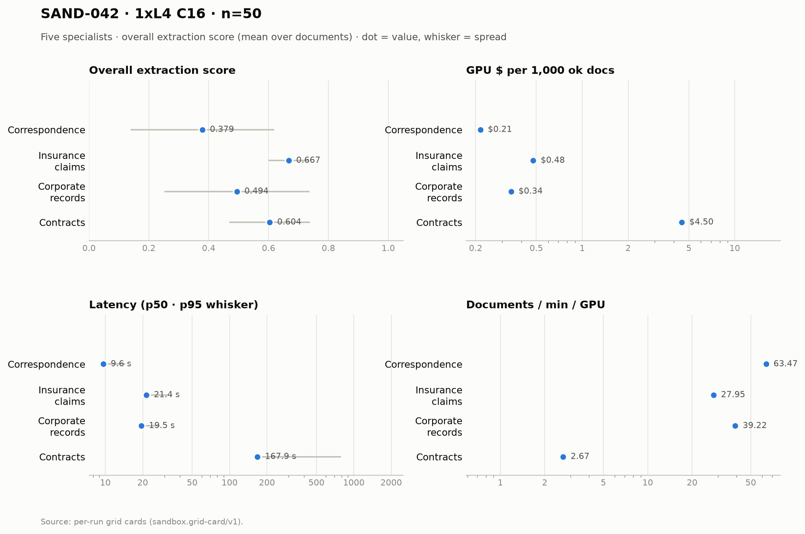

# SAND-042 · 1× L4 · client concurrency 16 · n=50 × 5 specialists

**Cells reported:** 5 of 5 · **Runbook:** `sand42-1l4-c16` · **Model:** Qwen/Qwen3-8B-AWQ · L4 @ $0.80/GPU-hr

## Shared conditions

| Condition | Value |
| --- | --- |
| Engine | Qwen/Qwen3-8B-AWQ · max_model_len 32768 · max_num_seqs 16/replica · max_inputs 32 |
| Fleet | 1 replica(s) · client concurrency 16 (16 per replica) |
| Dataset | `Lucius-Morningstar/mailroom-dataset` ground_truth @ ed7576b6, split=all, seed 42, one class bucket, 50 per class stratified over every subclass (min 1 per sub-type) |
| Prompt | v1 `*_simplified` stems only |
| Output cap | max_tokens 8,192 · temperature 0.7 contracts + merger, 0.1 elsewhere |
| GPU telemetry | in-container nvidia-smi series, label `sand42-1l4-c16` |

## Per specialist

| Metric | Correspondence | Insurance Claims | Corporate Records | Contracts | Merger Agreements |
| --- | ---: | ---: | ---: | ---: | ---: |
| Quality (95% CI) | 0.379 [0.313, 0.448] | 0.667 [0.649, 0.686] | 0.494 [0.428, 0.561] | 0.604 [0.566, 0.641] | 0.028 [0.017, 0.039] |
| Scored documents | 50 | 50 | 50 | 50 | 50 |
| Quality SD | 0.240 | 0.067 | 0.243 | 0.134 | 0.041 |
| Scoring method | suite | suite | suite | suite+cuad | suite+maud |
| Clause metric | n/a (no clause scoring) | n/a (no clause scoring) | n/a (no clause scoring) | CUAD F1 0.614 · 50 labeled | MAUD acc 2.8% · 286/811 answered |
| Ok rate (Wilson) | 50/50 100.0% [0.929, 1.000] | 50/50 100.0% [0.929, 1.000] | 50/50 100.0% [0.929, 1.000] | 50/50 100.0% [0.929, 1.000] | 50/50 100.0% [0.929, 1.000] |
| Schema-valid rate | 100.0% | 34.0% | 96.0% | 100.0% | 100.0% |
| Parse errors | 0 | 0 | 0 | 0 | 0 |
| Length-capped | 0 | 0 | 0 | 0 | 0 |
| Error kinds | none | none | none | none | none |
| p50 latency (s) | 9.6 | 21.4 | 19.5 | 167.9 | 948.7 |
| p95 latency (s) | 14.4 | 31.9 | 27.3 | 791.9 | 1,917.9 |
| SLO (s) · met | 60 · yes | 60 · yes | 60 · yes | 300 · no | 1,800 · no |
| Documents/min | 63.47 | 27.95 | 39.22 | 2.67 | 0.73 |
| Documents/min/GPU | 63.47 | 27.95 | 39.22 | 2.67 | 0.73 |
| Goodput docs/min/GPU | 63.47 | 27.95 | 39.22 | 0.00 | 0.00 |
| Tokens/s/GPU | 2,903.2 | 1,737.9 | 2,685.3 | 857.9 | 1,258.8 |
| Mean TTFT (s) | 1.53 | 1.77 | 2.41 | 3.70 | 7.25 |
| Prefix-cache hit | 63.6% | 58.4% | 50.9% | 37.7% | 12.5% |
| Wall (s) | 47.3 | 107.3 | 76.5 | 1,124.4 | 4,098.5 |
| Billed GPU $ (run) | $0.0107 | $0.0239 | $0.0171 | $0.2250 | $0.8018 |
| $ / 1k ok docs | $0.214840 | $0.477120 | $0.341420 | $4.500700 | $16.036420 |
| $ / 1k schema-valid | $0.214840 | $1.403294 | $0.355646 | $4.500700 | $16.036420 |
| $ / doc | $0.000215 | $0.000477 | $0.000341 | $0.004501 | $0.016036 |
| $ / ok doc | $0.000215 | $0.000477 | $0.000341 | $0.004501 | $0.016036 |
| $ / 1M tokens | $0.078 | $0.128 | $0.083 | $0.233 | $0.155 |
| GPU util (mean/p95/min–max) | 61.8% mean / 100.0 p95 / 0.0–100.0% min–max (n=8) | 91.6% mean / 100.0 p95 / 0.0–100.0% min–max (n=16) | 82.4% mean / 100.0 p95 / 0.0–100.0% min–max (n=12) | 97.8% mean / 100.0 p95 / 0.0–100.0% min–max (n=166) | 98.8% mean / 100.0 p95 / 0.0–100.0% min–max (n=552) |
| GPU mem used (mean) | 20,996 MiB (91.2% of 23,034) | 21,026 MiB (91.3% of 23,034) | 21,026 MiB (91.3% of 23,034) | 21,026 MiB (91.3% of 23,034) | 21,025 MiB (91.3% of 23,034) |
| GPU mem bandwidth (mean) | 44.1% mean | 80.0% mean | 53.2% mean | 86.4% mean | 75.8% mean |
| Sampling coverage | 100.0% | 100.0% | 100.0% | 100.0% | 93.1% |
| GPU power (W, mean) | 59.0 | 69.9 | 65.2 | 71.6 | 71.8 |
| GPU temp (C, mean) | 68.5 | 76.9 | 77.2 | 76.6 | 73.9 |
| KV cache use, mid-run (max %) | 8.0% | 15.1% | 21.9% | 74.8% | 95.1% |
| Queue depth, mid-run (running/waiting) | 14 running / 0 waiting | 16 running / 0 waiting | 16 running / 0 waiting | 16 running / 6 waiting | 16 running / 14 waiting |
| Preemptions | 0 | 0 | 0 | 0 | 0 |
| Length finishes | 0 | 0 | 0 | 2 | 2 |

## Figure

## Cost (computed from the session)

The fleet is pinned warm (`min_containers=1`) from deploy to teardown, so Modal meters the **whole window** — the cold boot and the idle between specialists included. This is computed from the session's own timestamps, not scraped from the billing CLI (whose figures are credits-based and workspace-wide).

| Fleet cost | Value |
| --- | ---: |
| Replicas × GPU | 1 × L4 @ $0.80/GPU-hr |
| Cold boot (deploy → ready) | 146.0 s |
| Fleet window (deploy → teardown) | 5,098.0 s |
| Fleet GPU-hours | 1.4161 |
| **Fleet GPU $** | **$1.1329** |
| Of which the five runs | 4,853.4 s (95.2%) |
| Boot + idle overhead | 244.6 s |

## Per-run cards

| Specialist | Run ID | Card |
| --- | --- | --- |
| Correspondence | `sand42-50-correspondence-specialist-awq-1l4-c16` | [sand42-50-correspondence-specialist-awq-1l4-c16.card.md](correspondence/sand42-50-correspondence-specialist-awq-1l4-c16.card.md) |
| Insurance Claims | `sand42-50-insurance-claims-specialist-awq-1l4-c16` | [sand42-50-insurance-claims-specialist-awq-1l4-c16.card.md](insurance_claims/sand42-50-insurance-claims-specialist-awq-1l4-c16.card.md) |
| Corporate Records | `sand42-50-corporate-records-specialist-awq-1l4-c16` | [sand42-50-corporate-records-specialist-awq-1l4-c16.card.md](corporate_records/sand42-50-corporate-records-specialist-awq-1l4-c16.card.md) |
| Contracts | `sand42-50-contracts-specialist-awq-1l4-c16` | [sand42-50-contracts-specialist-awq-1l4-c16.card.md](contracts/sand42-50-contracts-specialist-awq-1l4-c16.card.md) |
| Merger Agreements | `sand42-50-merger-specialist-awq-1l4-c16` | [sand42-50-merger-specialist-awq-1l4-c16.card.md](merger_agreement/sand42-50-merger-specialist-awq-1l4-c16.card.md) |

_Merger dominates pooled throughput (≈ 112k prompt tokens per agreement on the frozen settings), so no pooled column is reported here — compare per class._

_Generated 2026-10-13T04:33:13+00:00 by `sandbox run card --runbook sand42-1l4-c16` from the committed per-run `*.card.json`._
