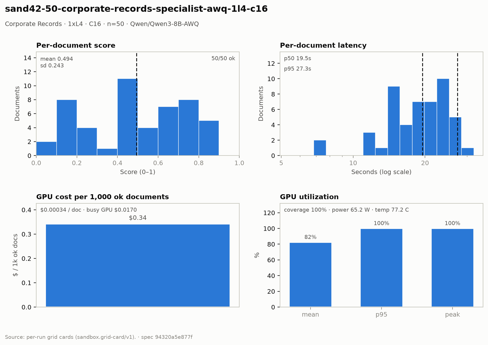

# Corporate Records — 1× L4 · C16 · n=50

**Run:** `sand42-50-corporate-records-specialist-awq-1l4-c16` · **Model:** Qwen/Qwen3-8B-AWQ · vLLM v0.29.0 · Modal `sandbox-vllm` · L4 @ $0.80/GPU-hr

## Conditions

| Condition | Value |
| --- | --- |
| Task | corporate_records_specialist |
| Prompt | corporate_records_specialist_simplified |
| Temperature | 0.1 (vendored call site) |
| Output cap (max_tokens) | 8,192 |
| Input cap (max_input_chars) | 15,000 |
| Job retries | 2 |
| Dataset | Lucius-Morningstar/mailroom-dataset ground_truth @ ed7576b6, split=all, seed 42 |
| Draw | 50 docs (fingerprint 76b083c7c46d) |
| Engine | awq_marlin · fp8 KV · CUDA graphs [1, 2, 4, 8, 16] · prefix caching on · thinking off |
| Admission | max_model_len 32768 · max_num_seqs 16 per replica · max_inputs 32 |

## Score & cost card

| Metric | Value |
| --- | ---: |
| **Run** |  |
| Run ID | `sand42-50-corporate-records-specialist-awq-1l4-c16` |
| GPUs / replicas | 1 |
| Concurrency | 16 (16 per replica) |
| Documents | 50 |
| Spec hash | 94320a5e… |
| **Time** |  |
| Wall (busy) | 76.49 s |
| GPU seconds | 76.82 s |
| Cold boot | 0.47 s |
| **Cost** |  |
| Busy-window GPU $ | $0.016998 |
| Billed GPU $ | $0.017071 |
| Billed seconds | 76.82 s |
| Idle $ | $0.003763 (16.93 s) |
| Cost per document | $0.000341 |
| Cost per ok document | $0.000341 |
| Cost per 1M tokens | $0.0831 |
| **Tokens** |  |
| Prompt tokens | 197,319 |
| Completion tokens | 8,075 (3.9%) |
| Total tokens | 205,394 |
| Tokens per document | 4,108 |
| Per document: instructions + template | 2,090 (50.9%) |
| Per document: document text | 1,856 (45.2%) |
| Per document: output | 162 (3.9%) |
| Instruction tokens per model call | 2,090 over 50 calls |
| Token split basis | fit across documents, 4.21 chars/token |
| Completion p95 / max (ok docs) | 198 / 239 |
| **Throughput** |  |
| Tokens / second | 2,685.3 |
| Tokens / second per L4 | 2,685.3 |
| Documents / minute | 39.22 |
| **Latency (per document, ok rows)** |  |
| Mean | 19.06 s |
| p50 | 19.52 s |
| p95 | 27.34 s |
| Max | 32.01 s |
| **Engine (vLLM /metrics)** |  |
| Parallelism (Σ latency ÷ wall) | 12.46× of 16 |
| Slot occupancy | 77.9% |
| Coverage | replicas observed: 1 of 1 |
| Requests per replica (this run) | 50 |
| Mean TTFT per replica | 2.411 s |
| Prefix-cache hit per replica | 50.9% |
| Preemptions per replica (this run) | 0 |
| Length-capped finishes per replica (this run) | 0 |
| **GPU hardware (nvidia-smi)** | 12 samples · serving-replica nvidia-smi |
| GPU utilization | 82.4 % mean (p95 100.0 / peak 100.0 / min 0.0) |
| Sampling coverage | 100.0 % |
| GPU power draw | 65.2 W (min 33.6 / max 72.2) of 72 W cap |
| GPU memory bandwidth | 53.2 % (min 0.0 / max 100.0) |
| GPU SM clock | 1,281 MHz (min 975 / max 2,040) |
| GPU temperature | 77.2 C (min 69.0 / max 82.0) |
| GPU memory used | 21,026 MiB (min 21,026 / max 21,026) |
| **Quality** |  |
| Overall extraction score | 0.4943 (sd 0.243) |
| Score min / max | 0.0635 / 0.8889 |
| Scoring method | `suite` |
| Schema-valid rate | 0.96 |
| Parse errors | 0 |
| Errors | 0 / 50 |
| **Paired n** |  |
| Documents a paired delta can use | 50 of 50 |

## Figure

## Per-document results

| # | Document | OK | Score | Latency (s) | Prompt tok | Completion tok | Error |
| ---: | --- | --- | ---: | ---: | ---: | ---: | --- |
| 1 | `DOC-020d77c0107d273d` | yes | 0.4746 | 19.5 | 2302 | 116 | — |
| 2 | `DOC-9ca44c7926a47ede` | yes | 0.5024 | 19.6 | 2292 | 130 | — |
| 3 | `DOC-c4c9c37a96291975` | yes | 0.0813 | 19.9 | 2424 | 136 | — |
| 4 | `DOC-91f89b9c0d285ac7` | yes | 0.6667 | 20.0 | 6902 | 126 | — |
| 5 | `DOC-0a262afc80c73247` | yes | 0.1136 | 23.1 | 3124 | 147 | — |
| 6 | `DOC-a040ac19abb88fec` | yes | 0.4097 | 23.1 | 2206 | 141 | — |
| 7 | `DOC-e545bbd5f5ea61b6` | yes | 0.3636 | 23.1 | 2788 | 156 | — |
| 8 | `DOC-6790430ae2a6c724` | yes | 0.1846 | 23.2 | 4477 | 143 | — |
| 9 | `DOC-0f56fe8db6df01bd` | yes | 0.0635 | 23.3 | 5368 | 161 | — |
| 10 | `DOC-fbcdd16e24f143ac` | yes | 0.1582 | 23.3 | 2456 | 155 | — |
| 11 | `DOC-12a6d4cd092cf66d` | yes | 0.5026 | 23.5 | 7710 | 158 | — |
| 12 | `DOC-81ae205a3b0bf16f` | yes | 0.2480 | 27.2 | 2515 | 158 | — |
| 13 | `DOC-732b812b7d9d9653` | yes | 0.8889 | 27.3 | 5572 | 165 | — |
| 14 | `DOC-01054efd0980066b` | yes | 0.8222 | 27.3 | 5122 | 158 | — |
| 15 | `DOC-2819b889b134ea01` | yes | 0.7500 | 27.7 | 5344 | 171 | — |
| 16 | `DOC-68d5a8753fcc3675` | yes | 0.4405 | 32.0 | 5671 | 189 | — |
| 17 | `DOC-9376c6bfa6779d5e` | yes | 0.4822 | 14.8 | 2200 | 124 | — |
| 18 | `DOC-e077f1f7e80e1e04` | yes | 0.1624 | 17.4 | 4043 | 160 | — |
| 19 | `DOC-f134b9491efc5c57` | yes | 0.7949 | 14.1 | 2865 | 141 | — |
| 20 | `DOC-2f19002c84083aa8` | yes | 0.4951 | 18.3 | 5200 | 170 | — |
| 21 | `DOC-474a0002b4c03be1` | yes | 0.8205 | 15.2 | 2938 | 149 | — |
| 22 | `DOC-e478fa89043a29e3` | yes | 0.8205 | 15.3 | 2910 | 151 | — |
| 23 | `DOC-a5fd7fe18b094f20` | yes | 0.7576 | 13.6 | 5919 | 139 | — |
| 24 | `DOC-b3ad98e5530dfeaf` | yes | 0.2820 | 23.4 | 2521 | 190 | — |
| 25 | `DOC-4dc719baa790a79c` | yes | 0.6667 | 21.0 | 2669 | 170 | — |
| 26 | `DOC-d015968793450753` | yes | 0.8056 | 20.8 | 5082 | 170 | — |
| 27 | `DOC-b832b5eaa2b4848c` | yes | 0.1068 | 16.8 | 2762 | 157 | — |
| 28 | `DOC-9467462d9bb34f8e` | yes | 0.5417 | 17.1 | 5345 | 158 | — |
| 29 | `DOC-204c3c7c0ba021cd` | yes | 0.4746 | 15.3 | 2226 | 152 | — |
| 30 | `DOC-1e8e3ce47882ae71` | yes | 0.1485 | 24.7 | 3063 | 198 | — |
| 31 | `DOC-fc9f56d999bd7566` | yes | 0.6667 | 24.7 | 2509 | 196 | — |
| 32 | `DOC-41b53ea487b84955` | yes | 0.7500 | 26.5 | 4617 | 239 | — |
| 33 | `DOC-bfa92eb6c72569ee` | yes | 0.4518 | 19.3 | 3771 | 160 | — |
| 34 | `DOC-37152a33cfb70d37` | yes | 0.4103 | 20.0 | 2902 | 161 | — |
| 35 | `DOC-ffb48271e0a5e812` | yes | 0.6667 | 18.7 | 5344 | 144 | — |
| 36 | `DOC-00193d0c070747e6` | yes | 0.7143 | 21.5 | 3225 | 181 | — |
| 37 | `DOC-0a8eb16fff7e67ca` | yes | 0.6923 | 19.9 | 5246 | 165 | — |
| 38 | `DOC-78f2456f571403a9` | yes | 0.1531 | 14.3 | 2345 | 144 | — |
| 39 | `DOC-2338d194d5250def` | yes | 0.5777 | 11.4 | 5258 | 136 | — |
| 40 | `DOC-f21f3dadebb121e3` | yes | 0.7843 | 18.1 | 3308 | 180 | — |
| 41 | `DOC-e6906e59f9bd74ca` | yes | 0.6200 | 14.8 | 2978 | 160 | — |
| 42 | `DOC-80e90a37bb750a3c` | yes | 0.1495 | 16.2 | 2776 | 183 | — |
| 43 | `DOC-606242f2919653a4` | yes | 0.2332 | 11.9 | 5253 | 160 | — |
| 44 | `DOC-842215e36884da89` | yes | 0.2467 | 12.0 | 5226 | 161 | — |
| 45 | `DOC-d4dfbfe8049d41f9` | yes | 0.4934 | 15.3 | 3856 | 180 | — |
| 46 | `DOC-866139125545b36a` | yes | 0.7733 | 15.3 | 5397 | 179 | — |
| 47 | `DOC-a973ebf005e0e785` | yes | 0.4278 | 21.8 | 6146 | 212 | — |
| 48 | `DOC-dfe42f3747f299e6` | yes | 0.7500 | 7.6 | 5870 | 161 | — |
| 49 | `DOC-d0aebe650be3e512` | yes | 0.4976 | 7.3 | 2405 | 163 | — |
| 50 | `DOC-27bbad54b6fd107e` | yes | 0.6250 | 5.4 | 2871 | 171 | — |

_Generated 2026-10-13T04:32:49+00:00 by `sandbox run card`. Machine-readable twin: `sand42-50-corporate-records-specialist-awq-1l4-c16.card.json`._
