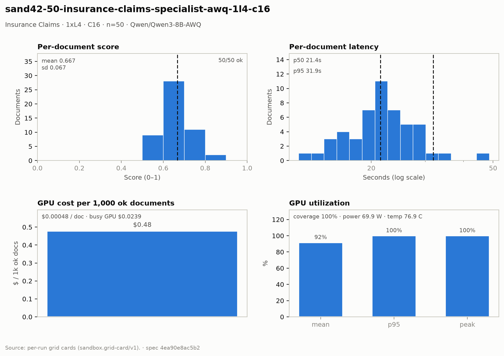

# Insurance Claims — 1× L4 · C16 · n=50

**Run:** `sand42-50-insurance-claims-specialist-awq-1l4-c16` · **Model:** Qwen/Qwen3-8B-AWQ · vLLM v0.29.0 · Modal `sandbox-vllm` · L4 @ $0.80/GPU-hr

## Conditions

| Condition | Value |
| --- | --- |
| Task | insurance_claims_specialist |
| Prompt | insurance_claims_specialist_simplified |
| Temperature | 0.1 (vendored call site) |
| Output cap (max_tokens) | 8,192 |
| Input cap (max_input_chars) | 13,500 |
| Job retries | 2 |
| Dataset | Lucius-Morningstar/mailroom-dataset ground_truth @ ed7576b6, split=all, seed 42 |
| Draw | 50 docs (fingerprint f4fdcee45e7f) |
| Engine | awq_marlin · fp8 KV · CUDA graphs [1, 2, 4, 8, 16] · prefix caching on · thinking off |
| Admission | max_model_len 32768 · max_num_seqs 16 per replica · max_inputs 32 |

## Score & cost card

| Metric | Value |
| --- | ---: |
| **Run** |  |
| Run ID | `sand42-50-insurance-claims-specialist-awq-1l4-c16` |
| GPUs / replicas | 1 |
| Concurrency | 16 (16 per replica) |
| Documents | 50 |
| Spec hash | 4ea90e8a… |
| **Time** |  |
| Wall (busy) | 107.33 s |
| GPU seconds | 107.35 s |
| Cold boot | 0.31 s |
| **Cost** |  |
| Busy-window GPU $ | $0.023852 |
| Billed GPU $ | $0.023856 |
| Billed seconds | 107.35 s |
| Idle $ | $0.008302 (37.36 s) |
| Cost per document | $0.000477 |
| Cost per ok document | $0.000477 |
| Cost per 1M tokens | $0.1279 |
| **Tokens** |  |
| Prompt tokens | 165,315 |
| Completion tokens | 21,216 (11.4%) |
| Total tokens | 186,531 |
| Tokens per document | 3,731 |
| Per document: instructions + template | 2,710 (72.6%) |
| Per document: document text | 597 (16.0%) |
| Per document: output | 424 (11.4%) |
| Instruction tokens per model call | 2,710 over 50 calls |
| Token split basis | fit across documents, 4.47 chars/token |
| Completion p95 / max (ok docs) | 630 / 1,402 |
| **Throughput** |  |
| Tokens / second | 1,737.9 |
| Tokens / second per L4 | 1,737.9 |
| Documents / minute | 27.95 |
| **Latency (per document, ok rows)** |  |
| Mean | 22.39 s |
| p50 | 21.41 s |
| p95 | 31.90 s |
| Max | 48.61 s |
| **Engine (vLLM /metrics)** |  |
| Parallelism (Σ latency ÷ wall) | 10.43× of 16 |
| Slot occupancy | 65.2% |
| Coverage | replicas observed: 1 of 1 |
| Requests per replica (this run) | 50 |
| Mean TTFT per replica | 1.768 s |
| Prefix-cache hit per replica | 58.4% |
| Preemptions per replica (this run) | 0 |
| Length-capped finishes per replica (this run) | 0 |
| **GPU hardware (nvidia-smi)** | 16 samples · serving-replica nvidia-smi |
| GPU utilization | 91.6 % mean (p95 100.0 / peak 100.0 / min 0.0) |
| Sampling coverage | 100.0 % |
| GPU power draw | 69.9 W (min 37.9 / max 73.3) of 72 W cap |
| GPU memory bandwidth | 80.0 % (min 0.0 / max 100.0) |
| GPU SM clock | 1,338 MHz (min 1,020 / max 2,040) |
| GPU temperature | 76.9 C (min 72.0 / max 81.0) |
| GPU memory used | 21,026 MiB (min 21,026 / max 21,026) |
| **Quality** |  |
| Overall extraction score | 0.6673 (sd 0.067) |
| Score min / max | 0.5579 / 0.8178 |
| Scoring method | `suite` |
| Schema-valid rate | 0.34 |
| Parse errors | 0 |
| Errors | 0 / 50 |
| **Paired n** |  |
| Documents a paired delta can use | 50 of 50 |

## Figure

## Per-document results

| # | Document | OK | Score | Latency (s) | Prompt tok | Completion tok | Error |
| ---: | --- | --- | ---: | ---: | ---: | ---: | --- |
| 1 | `DOC-2a33a6c34834e769` | yes | 0.6298 | 18.6 | 2953 | 337 | — |
| 2 | `DOC-2a55a2b5324659f8` | yes | 0.8098 | 18.6 | 2865 | 346 | — |
| 3 | `DOC-9ba0a3d4c680b976` | yes | 0.6398 | 18.6 | 2982 | 334 | — |
| 4 | `DOC-629fb5789dfd10ca` | yes | 0.7944 | 18.8 | 2836 | 352 | — |
| 5 | `DOC-2aea7f6dc44b37e1` | yes | 0.7741 | 19.0 | 2835 | 353 | — |
| 6 | `DOC-997823d9605a4a59` | yes | 0.6398 | 19.9 | 2973 | 361 | — |
| 7 | `DOC-e2a58ed4c02470c0` | yes | 0.7812 | 21.3 | 2835 | 365 | — |
| 8 | `DOC-e7c196f508907c6f` | yes | 0.7830 | 21.4 | 2834 | 361 | — |
| 9 | `DOC-9a6f58879fcb3367` | yes | 0.6442 | 21.4 | 2946 | 370 | — |
| 10 | `DOC-968c9605eab0a87d` | yes | 0.6442 | 21.4 | 2942 | 367 | — |
| 11 | `DOC-991cb72cb83c7a6c` | yes | 0.6442 | 21.5 | 2941 | 367 | — |
| 12 | `DOC-158c0b74df673b81` | yes | 0.6442 | 21.5 | 2939 | 367 | — |
| 13 | `DOC-ef79520b2f50217b` | yes | 0.6892 | 24.1 | 3138 | 390 | — |
| 14 | `DOC-2435c398b95844bc` | yes | 0.6879 | 26.7 | 3080 | 455 | — |
| 15 | `DOC-5b1e8e2aed95c089` | yes | 0.6873 | 29.7 | 3123 | 532 | — |
| 16 | `DOC-5c4e70db54374e72` | yes | 0.6763 | 29.9 | 3151 | 542 | — |
| 17 | `DOC-6f6fc9762418a70f` | yes | 0.7048 | 11.6 | 2811 | 238 | — |
| 18 | `DOC-00d28a1df0e3f6ba` | yes | 0.6971 | 14.3 | 2812 | 259 | — |
| 19 | `DOC-728d06b610b25244` | yes | 0.7043 | 14.4 | 2804 | 273 | — |
| 20 | `DOC-cbfcdb6f42cf2ae6` | yes | 0.6872 | 13.9 | 2806 | 275 | — |
| 21 | `DOC-00ccdcb0154a8629` | yes | 0.6228 | 14.1 | 2812 | 281 | — |
| 22 | `DOC-5060222215c75aa6` | yes | 0.7412 | 16.5 | 2801 | 296 | — |
| 23 | `DOC-c34baab0b5fe378a` | yes | 0.6232 | 15.4 | 2807 | 293 | — |
| 24 | `DOC-f5e6c0de5f1d8593` | yes | 0.6955 | 15.7 | 2812 | 301 | — |
| 25 | `DOC-29e384939c31d44a` | yes | 0.6131 | 15.9 | 3010 | 306 | — |
| 26 | `DOC-9051d4cf8d7ab452` | yes | 0.7322 | 20.2 | 3115 | 341 | — |
| 27 | `DOC-e4b1466ee8d1ff19` | yes | 0.7037 | 23.1 | 3113 | 400 | — |
| 28 | `DOC-2d7cc160b78a69c5` | yes | 0.6442 | 20.2 | 2979 | 396 | — |
| 29 | `DOC-d8df43ed4d8faf89` | yes | 0.6888 | 29.7 | 3107 | 524 | — |
| 30 | `DOC-0cdb706a0cdbe3b6` | yes | 0.6131 | 20.7 | 2981 | 363 | — |
| 31 | `DOC-87c0c53132830a6c` | yes | 0.6265 | 23.3 | 2993 | 397 | — |
| 32 | `DOC-93c8d133c296d536` | yes | 0.5829 | 20.9 | 2879 | 340 | — |
| 33 | `DOC-27b23fd94cc70d9d` | yes | 0.6052 | 22.1 | 2890 | 362 | — |
| 34 | `DOC-3ae2dc5d624e2120` | yes | 0.5999 | 21.2 | 2871 | 347 | — |
| 35 | `DOC-364435343e0a2250` | yes | 0.6474 | 25.9 | 3020 | 393 | — |
| 36 | `DOC-91da307f80433ae3` | yes | 0.5796 | 24.3 | 2894 | 358 | — |
| 37 | `DOC-4e21681f375a247d` | yes | 0.6426 | 27.5 | 2985 | 412 | — |
| 38 | `DOC-90338506fc792f32` | yes | 0.5956 | 23.9 | 2882 | 367 | — |
| 39 | `DOC-44bcd388c4710b71` | yes | 0.5837 | 24.3 | 2884 | 374 | — |
| 40 | `DOC-7bd9dbc1b39ad41d` | yes | 0.6036 | 36.0 | 3171 | 630 | — |
| 41 | `DOC-164aa748f84cef54` | yes | 0.5899 | 25.2 | 2911 | 410 | — |
| 42 | `DOC-73d64bbeb296bd95` | yes | 0.5976 | 28.8 | 4524 | 534 | — |
| 43 | `DOC-7f1f866b022cee63` | yes | 0.7825 | 26.8 | 4985 | 504 | — |
| 44 | `DOC-85314478b81710d9` | yes | 0.6287 | 19.4 | 5285 | 441 | — |
| 45 | `DOC-ab18f15b7a51f1ab` | yes | 0.7446 | 23.7 | 5538 | 532 | — |
| 46 | `DOC-384665a051d0fcd6` | yes | 0.6801 | 26.7 | 5208 | 591 | — |
| 47 | `DOC-1076ac5b4b0df386` | yes | 0.5735 | 19.5 | 4482 | 502 | — |
| 48 | `DOC-6dcc0b9ba494c25b` | yes | 0.8178 | 21.3 | 5114 | 570 | — |
| 49 | `DOC-5b97ae3f8558703c` | yes | 0.5579 | 31.9 | 4565 | 1005 | — |
| 50 | `DOC-02f77aa77391a8c2` | yes | 0.6864 | 48.6 | 5091 | 1402 | — |

_Generated 2026-10-13T04:32:51+00:00 by `sandbox run card`. Machine-readable twin: `sand42-50-insurance-claims-specialist-awq-1l4-c16.card.json`._
