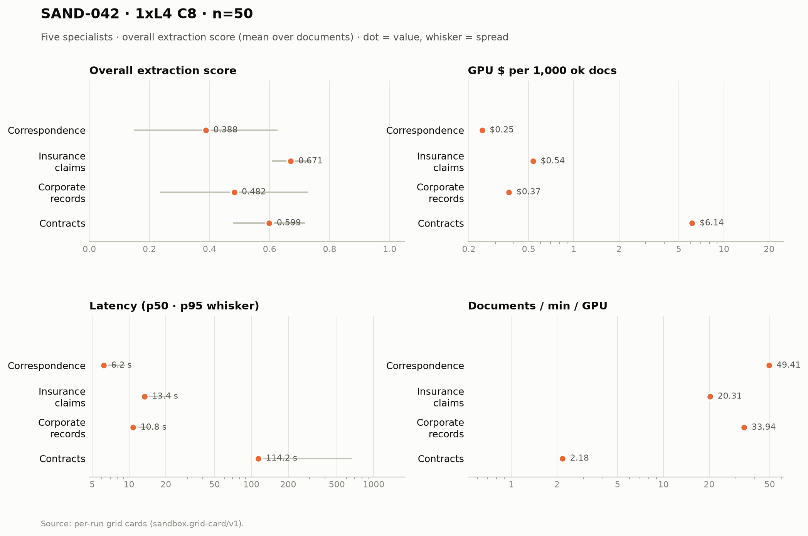

# SAND-042 · 1× L4 · client concurrency 8 · n=50 × 5 specialists

**Cells reported:** 5 of 5 · **Runbook:** `sand42-1l4-c8` · **Model:** Qwen/Qwen3-8B-AWQ · L4 @ $0.80/GPU-hr

## Shared conditions

| Condition | Value |
| --- | --- |
| Engine | Qwen/Qwen3-8B-AWQ · max_model_len 32768 · max_num_seqs 16/replica · max_inputs 32 |
| Fleet | 1 replica(s) · client concurrency 8 (8 per replica) |
| Dataset | `Lucius-Morningstar/mailroom-dataset` ground_truth @ ed7576b6, split=all, seed 42, one class bucket, 50 per class stratified over every subclass (min 1 per sub-type) |
| Prompt | v1 `*_simplified` stems only |
| Output cap | max_tokens 8,192 · temperature 0.7 contracts + merger, 0.1 elsewhere |
| GPU telemetry | in-container nvidia-smi series, label `sand42-1l4-c8` |

## Per specialist

| Metric | Correspondence | Insurance Claims | Corporate Records | Contracts | Merger Agreements |
| --- | ---: | ---: | ---: | ---: | ---: |
| Quality (95% CI) | 0.388 [0.323, 0.451] | 0.671 [0.654, 0.688] | 0.482 [0.413, 0.555] | 0.599 [0.565, 0.632] | 0.027 [0.017, 0.040] |
| Scored documents | 50 | 50 | 50 | 50 | 50 |
| Quality SD | 0.238 | 0.062 | 0.248 | 0.120 | 0.041 |
| Scoring method | suite | suite | suite | suite+cuad | suite+maud |
| Clause metric | n/a (no clause scoring) | n/a (no clause scoring) | n/a (no clause scoring) | CUAD F1 0.593 · 50 labeled | MAUD acc 2.7% · 302/811 answered |
| Ok rate (Wilson) | 50/50 100.0% [0.929, 1.000] | 50/50 100.0% [0.929, 1.000] | 50/50 100.0% [0.929, 1.000] | 50/50 100.0% [0.929, 1.000] | 50/50 100.0% [0.929, 1.000] |
| Schema-valid rate | 100.0% | 32.0% | 96.0% | 100.0% | 100.0% |
| Parse errors | 0 | 0 | 0 | 0 | 0 |
| Length-capped | 0 | 0 | 0 | 0 | 0 |
| Error kinds | none | none | none | none | none |
| p50 latency (s) | 6.2 | 13.4 | 10.8 | 114.2 | 547.4 |
| p95 latency (s) | 9.3 | 22.3 | 14.5 | 671.4 | 1,370.2 |
| SLO (s) · met | 60 · yes | 60 · yes | 60 · yes | 300 · no | 1,800 · yes |
| Documents/min | 49.41 | 20.31 | 33.94 | 2.18 | 0.64 |
| Documents/min/GPU | 49.41 | 20.31 | 33.94 | 2.18 | 0.64 |
| Goodput docs/min/GPU | 49.41 | 20.31 | 33.94 | 0.00 | 0.64 |
| Tokens/s/GPU | 2,261.7 | 1,258.3 | 2,324.3 | 688.5 | 1,113.4 |
| Mean TTFT (s) | 0.66 | 0.77 | 1.20 | 2.03 | 3.77 |
| Prefix-cache hit | 63.6% | 58.4% | 50.9% | 40.9% | 19.6% |
| Wall (s) | 60.7 | 147.7 | 88.4 | 1,378.0 | 4,657.5 |
| Billed GPU $ (run) | $0.0123 | $0.0268 | $0.0185 | $0.3069 | $0.9964 |
| $ / 1k ok docs | $0.245320 | $0.536240 | $0.370180 | $6.137540 | $19.927040 |
| $ / 1k schema-valid | $0.245320 | $1.675750 | $0.385604 | $6.137540 | $19.927040 |
| $ / doc | $0.000245 | $0.000536 | $0.000370 | $0.006138 | $0.019927 |
| $ / ok doc | $0.000245 | $0.000536 | $0.000370 | $0.006138 | $0.019927 |
| $ / 1M tokens | $0.089 | $0.144 | $0.090 | $0.323 | $0.192 |
| GPU util (mean/p95/min–max) | 87.2% mean / 100.0 p95 / 0.0–100.0% min–max (n=8) | 93.2% mean / 100.0 p95 / 0.0–100.0% min–max (n=18) | 84.6% mean / 100.0 p95 / 0.0–100.0% min–max (n=14) | 97.4% mean / 100.0 p95 / 0.0–100.0% min–max (n=231) | 88.7% mean / 100.0 p95 / 0.0–100.0% min–max (n=747) |
| GPU mem used (mean) | 21,027 MiB (91.3% of 23,034) | 21,028 MiB (91.3% of 23,034) | 21,028 MiB (91.3% of 23,034) | 21,028 MiB (91.3% of 23,034) | 21,028 MiB (91.3% of 23,034) |
| GPU mem bandwidth (mean) | 59.0% mean | 82.6% mean | 69.6% mean | 90.1% mean | 70.8% mean |
| Sampling coverage | 100.0% | 99.2% | 100.0% | 99.9% | 99.9% |
| GPU power (W, mean) | 64.6 | 70.2 | 64.7 | 71.3 | 67.5 |
| GPU temp (C, mean) | 53.0 | 63.8 | 69.4 | 75.1 | 73.9 |
| KV cache use, mid-run (max %) | 6.4% | 6.5% | 10.2% | 42.1% | 49.7% |
| Queue depth, mid-run (running/waiting) | 8 running / 0 waiting | 8 running / 0 waiting | 8 running / 0 waiting | 9 running / 0 waiting | 8 running / 2 waiting |
| Preemptions | 0 | 0 | 0 | 0 | 0 |
| Length finishes | 0 | 0 | 0 | 3 | 4 |

## Figure

## Cost (computed from the session)

The fleet is pinned warm (`min_containers=1`) from deploy to teardown, so Modal meters the **whole window** — the cold boot and the idle between specialists included. This is computed from the session's own timestamps, not scraped from the billing CLI (whose figures are credits-based and workspace-wide).

| Fleet cost | Value |
| --- | ---: |
| Replicas × GPU | 1 × L4 @ $0.80/GPU-hr |
| Cold boot (deploy → ready) | 122.0 s |
| Fleet window (deploy → teardown) | 6,427.0 s |
| Fleet GPU-hours | 1.7853 |
| **Fleet GPU $** | **$1.4282** |
| Of which the five runs | 6,123.7 s (95.3%) |
| Boot + idle overhead | 303.3 s |

## Per-run cards

| Specialist | Run ID | Card |
| --- | --- | --- |
| Correspondence | `sand42-50-correspondence-specialist-awq-1l4-c8` | [sand42-50-correspondence-specialist-awq-1l4-c8.card.md](correspondence/sand42-50-correspondence-specialist-awq-1l4-c8.card.md) |
| Insurance Claims | `sand42-50-insurance-claims-specialist-awq-1l4-c8` | [sand42-50-insurance-claims-specialist-awq-1l4-c8.card.md](insurance_claims/sand42-50-insurance-claims-specialist-awq-1l4-c8.card.md) |
| Corporate Records | `sand42-50-corporate-records-specialist-awq-1l4-c8` | [sand42-50-corporate-records-specialist-awq-1l4-c8.card.md](corporate_records/sand42-50-corporate-records-specialist-awq-1l4-c8.card.md) |
| Contracts | `sand42-50-contracts-specialist-awq-1l4-c8` | [sand42-50-contracts-specialist-awq-1l4-c8.card.md](contracts/sand42-50-contracts-specialist-awq-1l4-c8.card.md) |
| Merger Agreements | `sand42-50-merger-specialist-awq-1l4-c8` | [sand42-50-merger-specialist-awq-1l4-c8.card.md](merger_agreement/sand42-50-merger-specialist-awq-1l4-c8.card.md) |

_Merger dominates pooled throughput (≈ 112k prompt tokens per agreement on the frozen settings), so no pooled column is reported here — compare per class._

_Generated 2026-10-13T04:33:13+00:00 by `sandbox run card --runbook sand42-1l4-c8` from the committed per-run `*.card.json`._
