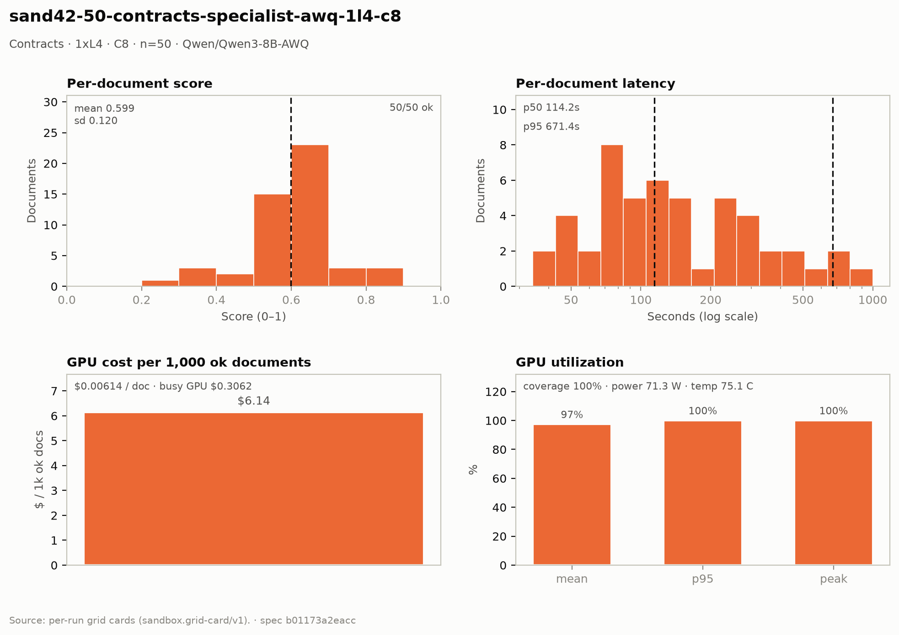

# Contracts — 1× L4 · C8 · n=50

**Run:** `sand42-50-contracts-specialist-awq-1l4-c8` · **Model:** Qwen/Qwen3-8B-AWQ · vLLM v0.29.0 · Modal `sandbox-vllm` · L4 @ $0.80/GPU-hr

## Conditions

| Condition | Value |
| --- | --- |
| Task | contracts_specialist |
| Prompt | contracts_specialist_v33_simplified |
| Temperature | 0.7 (posture knob) |
| Output cap (max_tokens) | 8,192 |
| Input cap (max_input_chars) | 49,000 |
| Chunk window (chars) | 43000 |
| Chunk overlap (chars) | 6000 |
| Job retries | 2 |
| Dataset | Lucius-Morningstar/mailroom-dataset ground_truth @ ed7576b6, split=all, seed 42 |
| Draw | 50 docs (fingerprint 5344b28a3033) |
| Engine | awq_marlin · fp8 KV · CUDA graphs [1, 2, 4, 8, 16] · prefix caching on · thinking off |
| Admission | max_model_len 32768 · max_num_seqs 16 per replica · max_inputs 32 |

## Score & cost card

| Metric | Value |
| --- | ---: |
| **Run** |  |
| Run ID | `sand42-50-contracts-specialist-awq-1l4-c8` |
| GPUs / replicas | 1 |
| Concurrency | 8 (8 per replica) |
| Documents | 50 |
| Spec hash | b01173a2… |
| **Time** |  |
| Wall (busy) | 1,377.99 s |
| GPU seconds | 1,380.95 s |
| Cold boot | 0.16 s |
| **Cost** |  |
| Busy-window GPU $ | $0.306219 |
| Billed GPU $ | $0.306877 |
| Billed seconds | 1,380.95 s |
| Idle $ | $0.031219 (140.49 s) |
| Cost per document | $0.006138 |
| Cost per ok document | $0.006138 |
| Cost per 1M tokens | $0.3235 |
| **Tokens** |  |
| Prompt tokens | 816,380 |
| Completion tokens | 132,358 (14.0%) |
| Total tokens | 948,738 |
| Tokens per document | 18,975 |
| Per document: instructions + template | 3,673 (19.4%) |
| Per document: document text | 12,655 (66.7%) |
| Per document: output | 2,647 (14.0%) |
| Instruction tokens per model call | 2,063 over 89 calls |
| Token split basis | document chars ÷ 4.5 chars/token; instructions are the remainder |
| Completion p95 / max (ok docs) | 6,299 / 10,611 |
| **Throughput** |  |
| Tokens / second | 688.5 |
| Tokens / second per L4 | 688.5 |
| Documents / minute | 2.18 |
| **Latency (per document, ok rows)** |  |
| Mean | 198.00 s |
| p50 | 114.24 s |
| p95 | 671.37 s |
| Max | 1,001.06 s |
| **Engine (vLLM /metrics)** |  |
| Parallelism (Σ latency ÷ wall) | 7.18× of 8 |
| Slot occupancy | 89.8% |
| Coverage | replicas observed: 1 of 1 |
| Requests per replica (this run) | 94 |
| Mean TTFT per replica | 2.031 s |
| Prefix-cache hit per replica | 40.9% |
| Preemptions per replica (this run) | 0 |
| Length-capped finishes per replica (this run) | 3 |
| **GPU hardware (nvidia-smi)** | 231 samples · serving-replica nvidia-smi |
| GPU utilization | 97.4 % mean (p95 100.0 / peak 100.0 / min 0.0) |
| Sampling coverage | 99.9 % |
| GPU power draw | 71.3 W (min 30.8 / max 73.8) of 72 W cap |
| GPU memory bandwidth | 90.1 % (min 0.0 / max 100.0) |
| GPU SM clock | 1,333 MHz (min 1,020 / max 2,040) |
| GPU temperature | 75.1 C (min 65.0 / max 84.0) |
| GPU memory used | 21,028 MiB (min 21,028 / max 21,028) |
| **Quality** |  |
| Overall extraction score | 0.5988 (sd 0.120) |
| Score min / max | 0.2727 / 0.8571 |
| Scoring method | `suite+cuad` |
| Schema-valid rate | 1.00 |
| Parse errors | 0 |
| Errors | 0 / 50 |
| **Clause scoring (CUAD)** |  |
| Docs with CUAD labels | 50 |
| Micro precision / recall / F1 | 0.599 / 0.587 / 0.593 |
| Metadata value checks | 86 / 140 |
| Suite field score (mean) | not captured |
| **Paired n** |  |
| Documents a paired delta can use | 50 of 50 |

## Figure

## Per-document results

| # | Document | OK | Score | Latency (s) | Prompt tok | Completion tok | Error |
| ---: | --- | --- | ---: | ---: | ---: | ---: | --- |
| 1 | `DOC-e235bc9735f96335` | yes | 0.6667 | 55.3 | 10699 | 940 | — |
| 2 | `DOC-3c07c9ccd9a01d6e` | yes | 0.8000 | 83.2 | 7428 | 1471 | — |
| 3 | `DOC-f5a54932794ef16e` | yes | 0.7500 | 90.2 | 5302 | 1596 | — |
| 4 | `DOC-593f2c6de770b84c` | yes | 0.6667 | 94.4 | 9228 | 1659 | — |
| 5 | `DOC-385a86c69f8e562c` | yes | 0.6667 | 113.9 | 6560 | 1953 | — |
| 6 | `DOC-268df6c8fabb385a` | yes | 0.6667 | 82.6 | 5201 | 1445 | — |
| 7 | `DOC-a7ea445212692b88` | yes | 0.6207 | 114.6 | 9369 | 2001 | — |
| 8 | `DOC-eaa14fe106140524` | yes | 0.4167 | 43.0 | 7001 | 948 | — |
| 9 | `DOC-4fb6419e37bff201` | yes | 0.6667 | 246.2 | 22234 | 4485 | — |
| 10 | `DOC-e4272758b561f8cd` | yes | 0.5556 | 73.6 | 6987 | 1442 | — |
| 11 | `DOC-0752e0811f5f5eb7` | yes | 0.3673 | 287.1 | 41619 | 5347 | — |
| 12 | `DOC-cbc1f0d62edbb23e` | yes | 0.5455 | 45.7 | 4155 | 944 | — |
| 13 | `DOC-2c3a9c3168cd0e3a` | yes | 0.6667 | 37.1 | 3385 | 799 | — |
| 14 | `DOC-73055dbb1e9f5f2f` | yes | 0.6857 | 233.1 | 49409 | 4517 | — |
| 15 | `DOC-f8b0d4bcbac60ca2` | yes | 0.5455 | 47.9 | 3824 | 994 | — |
| 16 | `DOC-1843cfdaf5db1840` | yes | 0.2727 | 117.6 | 7407 | 2446 | — |
| 17 | `DOC-81c4ce12d907380c` | yes | 0.5714 | 110.9 | 7047 | 2040 | — |
| 18 | `DOC-812192e392d8d410` | yes | 0.6000 | 105.0 | 5551 | 1974 | — |
| 19 | `DOC-9cee2e10b449a71c` | yes | 0.6875 | 133.7 | 21752 | 2382 | — |
| 20 | `DOC-b83763aeff114369` | yes | 0.6429 | 111.1 | 7446 | 1904 | — |
| 21 | `DOC-2b510409d3b9a4a6` | yes | 0.3333 | 508.0 | 9632 | 1117 | — |
| 22 | `DOC-9a36838df2878b37` | yes | 0.4000 | 159.9 | 8142 | 2454 | — |
| 23 | `DOC-035731e655e67aab` | yes | 0.5556 | 164.3 | 5207 | 2773 | — |
| 24 | `DOC-e998c563b82122b9` | yes | 0.5263 | 79.2 | 10006 | 1401 | — |
| 25 | `DOC-1e22a2d4068b8650` | yes | 0.8571 | 71.9 | 7587 | 1478 | — |
| 26 | `DOC-e29140d2e8e989be` | yes | 0.6400 | 671.4 | 33913 | 3993 | — |
| 27 | `DOC-70f90b46b2c4f1a6` | yes | 0.6667 | 34.2 | 3154 | 623 | — |
| 28 | `DOC-27b649fe2f6fae8e` | yes | 0.7778 | 75.6 | 5464 | 1345 | — |
| 29 | `DOC-712c3f92a0a56b77` | yes | 0.6286 | 267.1 | 56227 | 4552 | — |
| 30 | `DOC-8993ad1085e08bd0` | yes | 0.6207 | 95.6 | 22402 | 1710 | — |
| 31 | `DOC-1ddc9333769d27e4` | yes | 0.6154 | 50.6 | 4450 | 946 | — |
| 32 | `DOC-dfb4e69a3ab10dc9` | yes | 0.3182 | 61.3 | 7378 | 1303 | — |
| 33 | `DOC-1266801f2faad19f` | yes | 0.5882 | 354.8 | 33383 | 6299 | — |
| 34 | `DOC-fe06800cc62e5e19` | yes | 0.6207 | 82.8 | 8619 | 1742 | — |
| 35 | `DOC-472f423cdf0819ef` | yes | 0.6667 | 212.2 | 4656 | 1037 | — |
| 36 | `DOC-53e364f030a30b5c` | yes | 0.7541 | 728.5 | 94991 | 10611 | — |
| 37 | `DOC-c9d4c4f8ff433527` | yes | 0.5217 | 158.4 | 7730 | 1301 | — |
| 38 | `DOC-62b300182901e850` | yes | 0.6667 | 385.6 | 33346 | 2024 | — |
| 39 | `DOC-e0d31c39359cb803` | yes | 0.5882 | 98.7 | 6879 | 835 | — |
| 40 | `DOC-d6b6b418dd211b76` | yes | 0.6207 | 281.6 | 7293 | 3222 | — |
| 41 | `DOC-3f4003eb02433292` | yes | 0.5455 | 136.8 | 4421 | 1952 | — |
| 42 | `DOC-a6f559e4010fc8d1` | yes | 0.5294 | 1,001.1 | 32594 | 3134 | — |
| 43 | `DOC-4b57f485708ab60b` | yes | 0.6000 | 167.8 | 6639 | 2777 | — |
| 44 | `DOC-dbe52fd78e44b0ef` | yes | 0.8000 | 109.9 | 18750 | 1896 | — |
| 45 | `DOC-01849fa3020a5ac1` | yes | 0.5000 | 72.8 | 4173 | 1307 | — |
| 46 | `DOC-8f737e9fec8f24f0` | yes | 0.5455 | 513.2 | 35815 | 6087 | — |
| 47 | `DOC-aca7df716d7eef00` | yes | 0.6667 | 434.6 | 36448 | 5997 | — |
| 48 | `DOC-e218d39bb2f3c5ef` | yes | 0.5600 | 220.8 | 19923 | 5096 | — |
| 49 | `DOC-dfd20f94bb76b6e4` | yes | 0.5366 | 215.9 | 21000 | 4957 | — |
| 50 | `DOC-6b67382dcf833c5b` | yes | 0.6286 | 259.5 | 24554 | 7102 | — |

_Generated 2026-10-13T04:32:40+00:00 by `sandbox run card`. Machine-readable twin: `sand42-50-contracts-specialist-awq-1l4-c8.card.json`._
