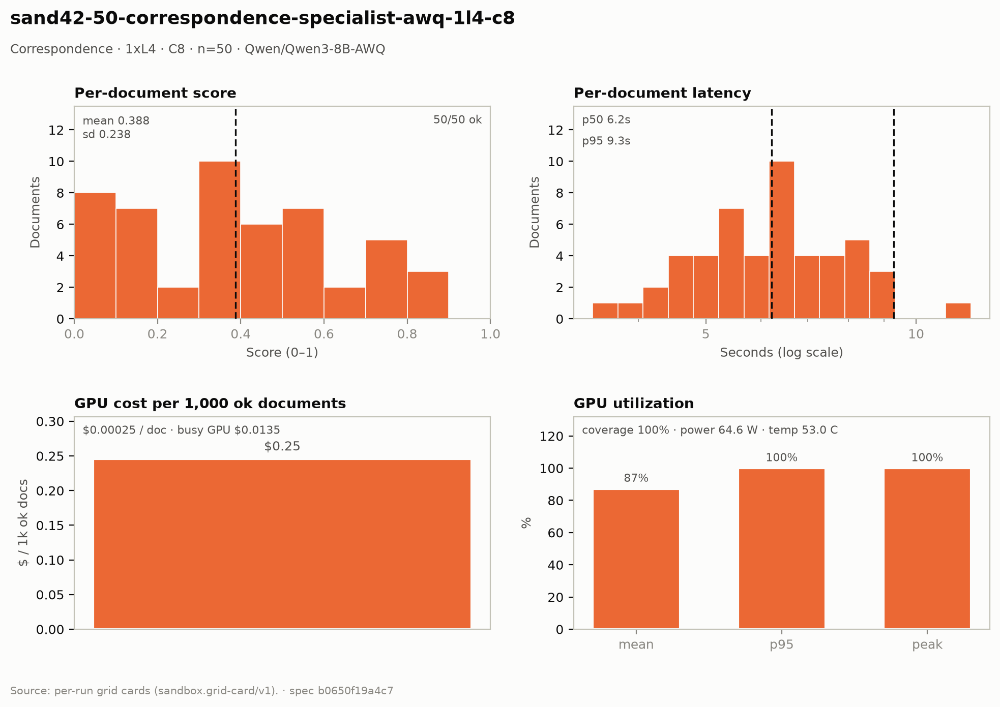

# Correspondence — 1× L4 · C8 · n=50

**Run:** `sand42-50-correspondence-specialist-awq-1l4-c8` · **Model:** Qwen/Qwen3-8B-AWQ · vLLM v0.29.0 · Modal `sandbox-vllm` · L4 @ $0.80/GPU-hr

## Conditions

| Condition | Value |
| --- | --- |
| Task | correspondence_specialist |
| Prompt | correspondence_specialist_simplified |
| Temperature | 0.1 (vendored call site) |
| Output cap (max_tokens) | 8,192 |
| Input cap (max_input_chars) | 12,000 |
| Job retries | 2 |
| Dataset | Lucius-Morningstar/mailroom-dataset ground_truth @ ed7576b6, split=all, seed 42 |
| Draw | 50 docs (fingerprint a00ba5dc0159) |
| Engine | awq_marlin · fp8 KV · CUDA graphs [1, 2, 4, 8, 16] · prefix caching on · thinking off |
| Admission | max_model_len 32768 · max_num_seqs 16 per replica · max_inputs 32 |

## Score & cost card

| Metric | Value |
| --- | ---: |
| **Run** |  |
| Run ID | `sand42-50-correspondence-specialist-awq-1l4-c8` |
| GPUs / replicas | 1 |
| Concurrency | 8 (8 per replica) |
| Documents | 50 |
| Spec hash | b0650f19… |
| **Time** |  |
| Wall (busy) | 60.72 s |
| GPU seconds | 55.20 s |
| Cold boot | 0.15 s |
| **Cost** |  |
| Busy-window GPU $ | $0.013493 |
| Billed GPU $ | $0.012266 |
| Billed seconds | 55.20 s |
| Idle $ | $0.004665 (20.99 s) |
| Cost per document | $0.000245 |
| Cost per ok document | $0.000245 |
| Cost per 1M tokens | $0.0893 |
| **Tokens** |  |
| Prompt tokens | 129,444 |
| Completion tokens | 7,887 (5.7%) |
| Total tokens | 137,331 |
| Tokens per document | 2,747 |
| Per document: instructions + template | 2,241 (81.6%) |
| Per document: document text | 348 (12.7%) |
| Per document: output | 158 (5.7%) |
| Instruction tokens per model call | 2,241 over 50 calls |
| Token split basis | fit across documents, 4.38 chars/token |
| Completion p95 / max (ok docs) | 214 / 318 |
| **Throughput** |  |
| Tokens / second | 2,261.7 |
| Tokens / second per L4 | 2,261.7 |
| Documents / minute | 49.41 |
| **Latency (per document, ok rows)** |  |
| Mean | 6.36 s |
| p50 | 6.21 s |
| p95 | 9.28 s |
| Max | 11.98 s |
| **Engine (vLLM /metrics)** |  |
| Parallelism (Σ latency ÷ wall) | 5.23× of 8 |
| Slot occupancy | 65.4% |
| Coverage | replicas observed: 1 of 1 |
| Requests per replica (this run) | 50 |
| Mean TTFT per replica | 0.657 s |
| Prefix-cache hit per replica | 63.6% |
| Preemptions per replica (this run) | 0 |
| Length-capped finishes per replica (this run) | 0 |
| **GPU hardware (nvidia-smi)** | 8 samples · serving-replica nvidia-smi |
| GPU utilization | 87.2 % mean (p95 100.0 / peak 100.0 / min 0.0) |
| Sampling coverage | 100.0 % |
| GPU power draw | 64.6 W (min 29.1 / max 73.0) of 72 W cap |
| GPU memory bandwidth | 59.0 % (min 0.0 / max 100.0) |
| GPU SM clock | 1,378 MHz (min 1,080 / max 2,040) |
| GPU temperature | 53.0 C (min 46.0 / max 58.0) |
| GPU memory used | 21,027 MiB (min 21,024 / max 21,028) |
| **Quality** |  |
| Overall extraction score | 0.3880 (sd 0.238) |
| Score min / max | 0.0278 / 0.8246 |
| Scoring method | `suite` |
| Schema-valid rate | 1.00 |
| Parse errors | 0 |
| Errors | 0 / 50 |
| **Paired n** |  |
| Documents a paired delta can use | 50 of 50 |

## Figure

## Per-document results

| # | Document | OK | Score | Latency (s) | Prompt tok | Completion tok | Error |
| ---: | --- | --- | ---: | ---: | ---: | ---: | --- |
| 1 | `DOC-2a7acfac00e67bac` | yes | 0.0278 | 6.2 | 2256 | 120 | — |
| 2 | `DOC-3c85eb56a4145e0c` | yes | 0.7143 | 6.2 | 2357 | 129 | — |
| 3 | `DOC-a21b03af9a6afc21` | yes | 0.8246 | 6.2 | 2412 | 130 | — |
| 4 | `DOC-fcab49d5955c76c0` | yes | 0.0606 | 6.2 | 2332 | 136 | — |
| 5 | `DOC-0dfd9710f2380220` | yes | 0.2050 | 8.1 | 2367 | 169 | — |
| 6 | `DOC-d9937f535b7c22f3` | yes | 0.3333 | 8.2 | 2447 | 173 | — |
| 7 | `DOC-3a21b2695c19d388` | yes | 0.0952 | 9.3 | 2766 | 199 | — |
| 8 | `DOC-fc6108235411ca8e` | yes | 0.0606 | 9.3 | 2465 | 201 | — |
| 9 | `DOC-3433644b29e318b3` | yes | 0.4967 | 5.4 | 2311 | 123 | — |
| 10 | `DOC-1de496e8c9350155` | yes | 0.3696 | 6.0 | 2314 | 138 | — |
| 11 | `DOC-c71d3ca0b727a0d4` | yes | 0.3333 | 4.9 | 2310 | 128 | — |
| 12 | `DOC-af2b2b54e31214cc` | yes | 0.3636 | 7.3 | 2822 | 178 | — |
| 13 | `DOC-275198e372250586` | yes | 0.1587 | 5.6 | 2880 | 150 | — |
| 14 | `DOC-bcc74152bde91996` | yes | 0.8095 | 4.4 | 2211 | 121 | — |
| 15 | `DOC-b7f699fd18d0f80c` | yes | 0.5185 | 7.8 | 2731 | 189 | — |
| 16 | `DOC-8ca6802d3a0f5d1a` | yes | 0.8148 | 6.6 | 3289 | 172 | — |
| 17 | `DOC-5cdfee2b0ef0a218` | yes | 0.5362 | 5.3 | 2263 | 146 | — |
| 18 | `DOC-e7b6158bfb232964` | yes | 0.5000 | 4.0 | 2246 | 115 | — |
| 19 | `DOC-ede2172372d1f296` | yes | 0.1111 | 5.2 | 2282 | 140 | — |
| 20 | `DOC-38a7cb4be93dbecd` | yes | 0.7778 | 5.9 | 2625 | 159 | — |
| 21 | `DOC-25958c023112a96e` | yes | 0.6667 | 6.1 | 2242 | 170 | — |
| 22 | `DOC-6bdc0c7c153547b6` | yes | 0.7451 | 8.1 | 2480 | 225 | — |
| 23 | `DOC-4fa7aa63b169fea8` | yes | 0.3333 | 5.4 | 2523 | 150 | — |
| 24 | `DOC-4ea9a8cde42f450b` | yes | 0.4667 | 5.5 | 2309 | 152 | — |
| 25 | `DOC-8674660f9ccc8243` | yes | 0.5362 | 5.1 | 2377 | 142 | — |
| 26 | `DOC-ba3217c0524a9577` | yes | 0.3333 | 4.8 | 2368 | 124 | — |
| 27 | `DOC-b78953fa896bdeb9` | yes | 0.5754 | 6.3 | 2441 | 171 | — |
| 28 | `DOC-bdf1d75db5874068` | yes | 0.7778 | 12.0 | 2839 | 318 | — |
| 29 | `DOC-5cef7d1205cc37d5` | yes | 0.1667 | 6.2 | 2581 | 153 | — |
| 30 | `DOC-3fd5fb2e4b505b04` | yes | 0.7647 | 7.3 | 2584 | 184 | — |
| 31 | `DOC-9417d989cb45b287` | yes | 0.0556 | 3.4 | 2212 | 89 | — |
| 32 | `DOC-315b7ca63910e311` | yes | 0.1939 | 7.9 | 2607 | 214 | — |
| 33 | `DOC-80c4ee15e95f8cc6` | yes | 0.0494 | 6.8 | 2631 | 166 | — |
| 34 | `DOC-65c30d7452215c4b` | yes | 0.1333 | 4.7 | 2272 | 129 | — |
| 35 | `DOC-a7e5e24fade86aae` | yes | 0.4545 | 6.2 | 3230 | 158 | — |
| 36 | `DOC-8b2609c15d1d37af` | yes | 0.4286 | 8.8 | 2604 | 204 | — |
| 37 | `DOC-537e1f953940c39c` | yes | 0.3333 | 8.0 | 2600 | 188 | — |
| 38 | `DOC-aff14c55ba2c4d16` | yes | 0.0769 | 6.2 | 3394 | 150 | — |
| 39 | `DOC-44dd971367dd458a` | yes | 0.6222 | 4.9 | 2298 | 113 | — |
| 40 | `DOC-fe0e62a4596a649b` | yes | 0.0606 | 6.2 | 2255 | 132 | — |
| 41 | `DOC-20dc95a39ec83250` | yes | 0.1911 | 7.2 | 2422 | 167 | — |
| 42 | `DOC-90326221a1667d50` | yes | 0.3333 | 7.1 | 3495 | 158 | — |
| 43 | `DOC-c4074ed5b08f097e` | yes | 0.3827 | 5.5 | 2255 | 128 | — |
| 44 | `DOC-5feb4a34e13ce77a` | yes | 0.4333 | 7.9 | 2415 | 174 | — |
| 45 | `DOC-f64e409a607594bb` | yes | 0.1768 | 5.5 | 2264 | 125 | — |
| 46 | `DOC-62d410af6bdd29f8` | yes | 0.2286 | 7.3 | 2520 | 182 | — |
| 47 | `DOC-6823b2f649cf1d0a` | yes | 0.4074 | 5.8 | 4888 | 141 | — |
| 48 | `DOC-851611e86c9e36d0` | yes | 0.5146 | 4.7 | 2806 | 141 | — |
| 49 | `DOC-f8fb6b01de0fc173` | yes | 0.5278 | 4.3 | 3169 | 142 | — |
| 50 | `DOC-e1e0cc74e784a403` | yes | 0.3212 | 4.7 | 2677 | 181 | — |

_Generated 2026-10-13T04:32:43+00:00 by `sandbox run card`. Machine-readable twin: `sand42-50-correspondence-specialist-awq-1l4-c8.card.json`._
