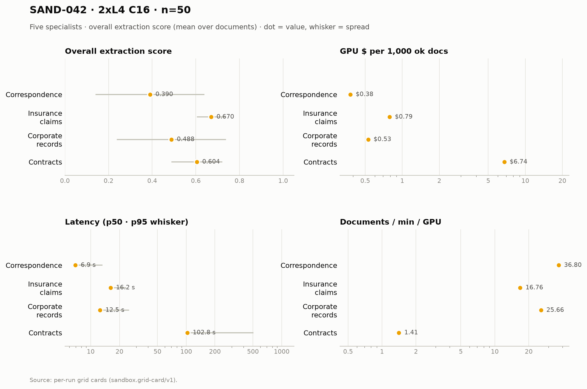

# SAND-042 · 2× L4 · client concurrency 16 (8 per replica) · n=50 × 5 specialists

**Cells reported:** 5 of 5 · **Runbook:** `sand42-2l4-c16` · **Model:** Qwen/Qwen3-8B-AWQ · L4 @ $0.80/GPU-hr

## Shared conditions

| Condition | Value |
| --- | --- |
| Engine | Qwen/Qwen3-8B-AWQ · max_model_len 32768 · max_num_seqs 16/replica · max_inputs 32 |
| Fleet | 2 replica(s) · client concurrency 16 (8 per replica) |
| Dataset | `Lucius-Morningstar/mailroom-dataset` ground_truth @ ed7576b6, split=all, seed 42, one class bucket, 50 per class stratified over every subclass (min 1 per sub-type) |
| Prompt | v1 `*_simplified` stems only |
| Output cap | max_tokens 8,192 · temperature 0.7 contracts + merger, 0.1 elsewhere |
| GPU telemetry | in-container nvidia-smi series, label `sand42-2l4-c16` |

## Per specialist

| Metric | Correspondence | Insurance Claims | Corporate Records | Contracts | Merger Agreements |
| --- | ---: | ---: | ---: | ---: | ---: |
| Quality (95% CI) | 0.390 [0.323, 0.459] | 0.670 [0.652, 0.688] | 0.488 [0.417, 0.557] | 0.604 [0.572, 0.637] | 0.025 [0.016, 0.035] |
| Scored documents | 50 | 50 | 50 | 50 | 50 |
| Quality SD | 0.249 | 0.065 | 0.250 | 0.117 | 0.033 |
| Scoring method | suite | suite | suite | suite+cuad | suite+maud |
| Clause metric | n/a (no clause scoring) | n/a (no clause scoring) | n/a (no clause scoring) | CUAD F1 0.612 · 50 labeled | MAUD acc 2.6% · 280/811 answered |
| Ok rate (Wilson) | 50/50 100.0% [0.929, 1.000] | 50/50 100.0% [0.929, 1.000] | 50/50 100.0% [0.929, 1.000] | 50/50 100.0% [0.929, 1.000] | 50/50 100.0% [0.929, 1.000] |
| Schema-valid rate | 100.0% | 30.0% | 96.0% | 100.0% | 100.0% |
| Parse errors | 0 | 0 | 0 | 0 | 0 |
| Length-capped | 0 | 0 | 0 | 0 | 0 |
| Error kinds | none | none | none | none | none |
| p50 latency (s) | 6.9 | 16.2 | 12.5 | 102.8 | 579.4 |
| p95 latency (s) | 13.3 | 23.6 | 25.3 | 504.7 | 1,047.8 |
| SLO (s) · met | 60 · yes | 60 · yes | 60 · yes | 300 · no | 1,800 · yes |
| Documents/min | 73.60 | 33.52 | 51.33 | 2.82 | 1.05 |
| Documents/min/GPU | 36.80 | 16.76 | 25.66 | 1.41 | 0.52 |
| Goodput docs/min/GPU | 36.80 | 16.76 | 25.66 | 0.00 | 0.52 |
| Tokens/s/GPU | 1,684.1 | 1,037.8 | 1,756.6 | 435.7 | 901.2 |
| Mean TTFT (s) | 1.30 | 1.30 | 1.63 | 3.51 | 4.39 |
| Prefix-cache hit | 62.5% | 56.9% | 49.9% | 37.4% | 17.3% |
| Wall (s) | 40.8 | 89.5 | 58.4 | 1,063.4 | 2,866.6 |
| Billed GPU $ (run) | $0.0189 | $0.0394 | $0.0264 | $0.3372 | $0.9321 |
| $ / 1k ok docs | $0.378140 | $0.787360 | $0.528320 | $6.744320 | $18.641200 |
| $ / 1k schema-valid | $0.378140 | $2.624533 | $0.550333 | $6.744320 | $18.641200 |
| $ / doc | $0.000378 | $0.000787 | $0.000528 | $0.006744 | $0.018641 |
| $ / ok doc | $0.000378 | $0.000787 | $0.000528 | $0.006744 | $0.018641 |
| $ / 1M tokens | $0.138 | $0.212 | $0.129 | $0.364 | $0.180 |
| GPU util (mean/p95/min–max) | 64.5% mean / 98.0 p95 / 0.0–100.0% min–max (n=12) | 67.4% mean / 100.0 p95 / 0.0–100.0% min–max (n=26) | 81.2% mean / 100.0 p95 / 0.0–100.0% min–max (n=17) | 90.6% mean / 100.0 p95 / 0.0–100.0% min–max (n=242) | 93.1% mean / 100.0 p95 / 0.0–100.0% min–max (n=675) |
| GPU mem used (mean) | 20,996 MiB (91.2% of 23,034) | 20,996 MiB (91.2% of 23,034) | 20,996 MiB (91.2% of 23,034) | 20,998 MiB (91.2% of 23,034) | 21,001 MiB (91.2% of 23,034) |
| GPU mem bandwidth (mean) | 62.3% mean | 61.8% mean | 65.1% mean | 84.6% mean | 74.5% mean |
| Sampling coverage | 100.0% | 100.0% | 97.9% | 98.9% | 99.6% |
| GPU power (W, mean) | 58.1 | 61.1 | 64.6 | 68.8 | 69.6 |
| GPU temp (C, mean) | 58.7 | 71.0 | 77.0 | 76.1 | 75.6 |
| KV cache use, mid-run (max %) | 4.8% | 9.4% | 17.6% | 50.1% | 90.2% |
| Queue depth, mid-run (running/waiting) | 8 running / 0 waiting | 8 running / 0 waiting | 13 running / 0 waiting | 12 running / 3 waiting | 16 running / 7 waiting |
| Preemptions | 0 | 0 | 0 | 0 | 0 |
| Length finishes | 0 | 0 | 0 | 1 | 5 |

## Figure

## Cost (computed from the session)

The fleet is pinned warm (`min_containers=1`) from deploy to teardown, so Modal meters the **whole window** — the cold boot and the idle between specialists included. This is computed from the session's own timestamps, not scraped from the billing CLI (whose figures are credits-based and workspace-wide).

| Fleet cost | Value |
| --- | ---: |
| Replicas × GPU | 2 × L4 @ $0.80/GPU-hr |
| Cold boot (deploy → ready) | 146.0 s |
| Fleet window (deploy → teardown) | 3,294.0 s |
| Fleet GPU-hours | 1.8300 |
| **Fleet GPU $** | **$1.4640** |
| Of which the five runs | 3,046.4 s (92.5%) |
| Boot + idle overhead | 247.6 s |

## Per-run cards

| Specialist | Run ID | Card |
| --- | --- | --- |
| Correspondence | `sand42-50-correspondence-specialist-awq-2l4-c16` | [sand42-50-correspondence-specialist-awq-2l4-c16.card.md](correspondence/sand42-50-correspondence-specialist-awq-2l4-c16.card.md) |
| Insurance Claims | `sand42-50-insurance-claims-specialist-awq-2l4-c16` | [sand42-50-insurance-claims-specialist-awq-2l4-c16.card.md](insurance_claims/sand42-50-insurance-claims-specialist-awq-2l4-c16.card.md) |
| Corporate Records | `sand42-50-corporate-records-specialist-awq-2l4-c16` | [sand42-50-corporate-records-specialist-awq-2l4-c16.card.md](corporate_records/sand42-50-corporate-records-specialist-awq-2l4-c16.card.md) |
| Contracts | `sand42-50-contracts-specialist-awq-2l4-c16` | [sand42-50-contracts-specialist-awq-2l4-c16.card.md](contracts/sand42-50-contracts-specialist-awq-2l4-c16.card.md) |
| Merger Agreements | `sand42-50-merger-specialist-awq-2l4-c16` | [sand42-50-merger-specialist-awq-2l4-c16.card.md](merger_agreement/sand42-50-merger-specialist-awq-2l4-c16.card.md) |

_Merger dominates pooled throughput (≈ 112k prompt tokens per agreement on the frozen settings), so no pooled column is reported here — compare per class._

_Generated 2026-10-13T04:33:14+00:00 by `sandbox run card --runbook sand42-2l4-c16` from the committed per-run `*.card.json`._
