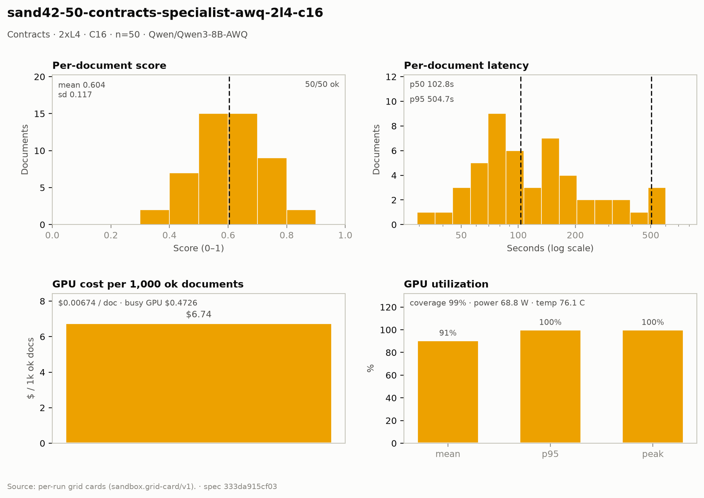

# Contracts — 2× L4 · C16 · n=50

**Run:** `sand42-50-contracts-specialist-awq-2l4-c16` · **Model:** Qwen/Qwen3-8B-AWQ · vLLM v0.29.0 · Modal `sandbox-vllm` · L4 @ $0.80/GPU-hr

## Conditions

| Condition | Value |
| --- | --- |
| Task | contracts_specialist |
| Prompt | contracts_specialist_v33_simplified |
| Temperature | 0.7 (posture knob) |
| Output cap (max_tokens) | 8,192 |
| Input cap (max_input_chars) | 49,000 |
| Chunk window (chars) | 43000 |
| Chunk overlap (chars) | 6000 |
| Job retries | 2 |
| Dataset | Lucius-Morningstar/mailroom-dataset ground_truth @ ed7576b6, split=all, seed 42 |
| Draw | 50 docs (fingerprint 5344b28a3033) |
| Engine | awq_marlin · fp8 KV · CUDA graphs [1, 2, 4, 8, 16] · prefix caching on · thinking off |
| Admission | max_model_len 32768 · max_num_seqs 16 per replica · max_inputs 32 |

## Score & cost card

| Metric | Value |
| --- | ---: |
| **Run** |  |
| Run ID | `sand42-50-contracts-specialist-awq-2l4-c16` |
| GPUs / replicas | 2 |
| Concurrency | 16 (8 per replica) |
| Documents | 50 |
| Spec hash | 333da915… |
| **Time** |  |
| Wall (busy) | 1,063.39 s |
| GPU seconds | 758.74 s |
| Cold boot | 0.34 s |
| **Cost** |  |
| Busy-window GPU $ | $0.472616 |
| Billed GPU $ | $0.337216 |
| Billed seconds | 758.74 s |
| Idle $ | $0.244364 (549.82 s) |
| Cost per document | $0.006744 |
| Cost per ok document | $0.006744 |
| Cost per 1M tokens | $0.3640 |
| **Tokens** |  |
| Prompt tokens | 803,470 |
| Completion tokens | 123,073 (13.3%) |
| Total tokens | 926,543 |
| Tokens per document | 18,531 |
| Per document: instructions + template | 3,415 (18.4%) |
| Per document: document text | 12,655 (68.3%) |
| Per document: output | 2,461 (13.3%) |
| Instruction tokens per model call | 1,918 over 89 calls |
| Token split basis | document chars ÷ 4.5 chars/token; instructions are the remainder |
| Completion p95 / max (ok docs) | 6,651 / 8,800 |
| **Throughput** |  |
| Tokens / second | 871.3 |
| Tokens / second per L4 | 435.7 |
| Documents / minute | 2.82 |
| **Latency (per document, ok rows)** |  |
| Mean | 164.34 s |
| p50 | 102.77 s |
| p95 | 504.66 s |
| Max | 744.94 s |
| **Engine (vLLM /metrics)** |  |
| Parallelism (Σ latency ÷ wall) | 7.73× of 16 |
| Slot occupancy | 48.3% |
| Coverage | replicas observed: 1 of 2 |
| Requests per replica (this run) | 48 |
| Mean TTFT per replica | 3.515 s |
| Prefix-cache hit per replica | 37.4% |
| Preemptions per replica (this run) | 0 |
| Length-capped finishes per replica (this run) | 1 |
| **GPU hardware (nvidia-smi)** | 242 samples · serving-replica nvidia-smi |
| GPU utilization | 90.6 % mean (p95 100.0 / peak 100.0 / min 0.0) |
| Sampling coverage | 98.9 % |
| GPU power draw | 68.8 W (min 32.5 / max 74.0) of 72 W cap |
| GPU memory bandwidth | 84.6 % (min 0.0 / max 100.0) |
| GPU SM clock | 1,386 MHz (min 975 / max 2,040) |
| GPU temperature | 76.1 C (min 68.0 / max 81.0) |
| GPU memory used | 20,998 MiB (min 20,996 / max 21,000) |
| **Quality** |  |
| Overall extraction score | 0.6044 (sd 0.117) |
| Score min / max | 0.3333 / 0.8571 |
| Scoring method | `suite+cuad` |
| Schema-valid rate | 1.00 |
| Parse errors | 0 |
| Errors | 0 / 50 |
| **Clause scoring (CUAD)** |  |
| Docs with CUAD labels | 50 |
| Micro precision / recall / F1 | 0.653 / 0.575 / 0.612 |
| Metadata value checks | 85 / 141 |
| Suite field score (mean) | not captured |
| **Paired n** |  |
| Documents a paired delta can use | 50 of 50 |

## Figure

## Per-document results

| # | Document | OK | Score | Latency (s) | Prompt tok | Completion tok | Error |
| ---: | --- | --- | ---: | ---: | ---: | ---: | --- |
| 1 | `DOC-268df6c8fabb385a` | yes | 0.6667 | 77.0 | 5201 | 938 | — |
| 2 | `DOC-e235bc9735f96335` | yes | 0.5116 | 84.8 | 10699 | 1073 | — |
| 3 | `DOC-a7ea445212692b88` | yes | 0.6667 | 88.6 | 9369 | 1911 | — |
| 4 | `DOC-e4272758b561f8cd` | yes | 0.5556 | 98.5 | 6987 | 1280 | — |
| 5 | `DOC-f5a54932794ef16e` | yes | 0.7778 | 107.1 | 5302 | 1377 | — |
| 6 | `DOC-eaa14fe106140524` | yes | 0.6250 | 109.0 | 7001 | 1394 | — |
| 7 | `DOC-3c07c9ccd9a01d6e` | yes | 0.7059 | 111.4 | 7428 | 1438 | — |
| 8 | `DOC-1843cfdaf5db1840` | yes | 0.6000 | 44.8 | 7407 | 639 | — |
| 9 | `DOC-385a86c69f8e562c` | yes | 0.6154 | 136.2 | 6560 | 1841 | — |
| 10 | `DOC-593f2c6de770b84c` | yes | 0.7500 | 136.4 | 9228 | 1830 | — |
| 11 | `DOC-f8b0d4bcbac60ca2` | yes | 0.5455 | 53.5 | 3824 | 1331 | — |
| 12 | `DOC-812192e392d8d410` | yes | 0.5714 | 47.5 | 5551 | 1075 | — |
| 13 | `DOC-cbc1f0d62edbb23e` | yes | 0.5000 | 84.0 | 4155 | 1874 | — |
| 14 | `DOC-2c3a9c3168cd0e3a` | yes | 0.6000 | 86.1 | 3385 | 1330 | — |
| 15 | `DOC-0752e0811f5f5eb7` | yes | 0.3333 | 177.8 | 41619 | 2658 | — |
| 16 | `DOC-73055dbb1e9f5f2f` | yes | 0.4667 | 183.9 | 49409 | 3837 | — |
| 17 | `DOC-9a36838df2878b37` | yes | 0.5833 | 67.2 | 8142 | 1382 | — |
| 18 | `DOC-035731e655e67aab` | yes | 0.5556 | 57.0 | 5207 | 1327 | — |
| 19 | `DOC-b83763aeff114369` | yes | 0.6207 | 97.3 | 7446 | 1550 | — |
| 20 | `DOC-4fb6419e37bff201` | yes | 0.6364 | 229.7 | 22234 | 4098 | — |
| 21 | `DOC-27b649fe2f6fae8e` | yes | 0.8000 | 58.3 | 5464 | 1316 | — |
| 22 | `DOC-70f90b46b2c4f1a6` | yes | 0.5714 | 29.3 | 3154 | 485 | — |
| 23 | `DOC-e998c563b82122b9` | yes | 0.5263 | 88.1 | 10006 | 1399 | — |
| 24 | `DOC-1e22a2d4068b8650` | yes | 0.7692 | 78.9 | 7587 | 1716 | — |
| 25 | `DOC-9cee2e10b449a71c` | yes | 0.7778 | 146.9 | 21752 | 2762 | — |
| 26 | `DOC-a6f559e4010fc8d1` | yes | 0.6250 | 272.7 | 43997 | 4136 | — |
| 27 | `DOC-1ddc9333769d27e4` | yes | 0.4706 | 70.3 | 4450 | 1147 | — |
| 28 | `DOC-dfb4e69a3ab10dc9` | yes | 0.5217 | 76.1 | 7378 | 1307 | — |
| 29 | `DOC-472f423cdf0819ef` | yes | 0.7500 | 80.5 | 4656 | 1339 | — |
| 30 | `DOC-fe06800cc62e5e19` | yes | 0.6207 | 89.9 | 8619 | 1473 | — |
| 31 | `DOC-c9d4c4f8ff433527` | yes | 0.5263 | 66.4 | 7730 | 964 | — |
| 32 | `DOC-e0d31c39359cb803` | yes | 0.6667 | 63.8 | 6879 | 973 | — |
| 33 | `DOC-8993ad1085e08bd0` | yes | 0.7895 | 191.5 | 22402 | 3630 | — |
| 34 | `DOC-d6b6b418dd211b76` | yes | 0.4828 | 145.0 | 7293 | 2449 | — |
| 35 | `DOC-3f4003eb02433292` | yes | 0.3750 | 95.6 | 4421 | 1664 | — |
| 36 | `DOC-62b300182901e850` | yes | 0.4545 | 210.0 | 33346 | 3292 | — |
| 37 | `DOC-4b57f485708ab60b` | yes | 0.6000 | 83.9 | 6639 | 1509 | — |
| 38 | `DOC-81c4ce12d907380c` | yes | 0.5714 | 328.3 | 7047 | 5732 | — |
| 39 | `DOC-01849fa3020a5ac1` | yes | 0.5000 | 47.2 | 4173 | 1077 | — |
| 40 | `DOC-dfd20f94bb76b6e4` | yes | 0.5833 | 151.0 | 21000 | 3008 | — |
| 41 | `DOC-8f737e9fec8f24f0` | yes | 0.6957 | 261.5 | 35815 | 4920 | — |
| 42 | `DOC-e218d39bb2f3c5ef` | yes | 0.4800 | 159.3 | 19923 | 3585 | — |
| 43 | `DOC-712c3f92a0a56b77` | yes | 0.5789 | 349.7 | 56227 | 6651 | — |
| 44 | `DOC-2b510409d3b9a4a6` | yes | 0.4615 | 504.7 | 21668 | 8578 | — |
| 45 | `DOC-dbe52fd78e44b0ef` | yes | 0.8571 | 146.5 | 18750 | 3000 | — |
| 46 | `DOC-6b67382dcf833c5b` | yes | 0.7857 | 169.3 | 24554 | 3773 | — |
| 47 | `DOC-e29140d2e8e989be` | yes | 0.7000 | 551.8 | 32801 | 3846 | — |
| 48 | `DOC-1266801f2faad19f` | yes | 0.6829 | 486.9 | 23527 | 2771 | — |
| 49 | `DOC-aca7df716d7eef00` | yes | 0.4242 | 391.3 | 24274 | 1588 | — |
| 50 | `DOC-53e364f030a30b5c` | yes | 0.6818 | 744.9 | 81784 | 8800 | — |

_Generated 2026-10-13T04:33:00+00:00 by `sandbox run card`. Machine-readable twin: `sand42-50-contracts-specialist-awq-2l4-c16.card.json`._
