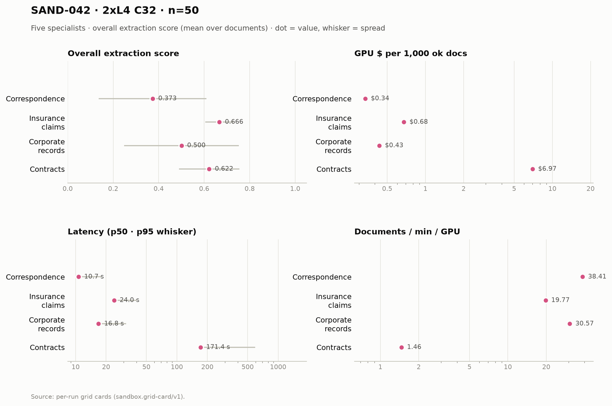

# SAND-042 · 2× L4 · client concurrency 32 (16 per replica) · n=50 × 5 specialists

**Cells reported:** 5 of 5 · **Runbook:** `sand42-2l4-c32` · **Model:** Qwen/Qwen3-8B-AWQ · L4 @ $0.80/GPU-hr

## Shared conditions

| Condition | Value |
| --- | --- |
| Engine | Qwen/Qwen3-8B-AWQ · max_model_len 32768 · max_num_seqs 16/replica · max_inputs 32 |
| Fleet | 2 replica(s) · client concurrency 32 (16 per replica) |
| Dataset | `Lucius-Morningstar/mailroom-dataset` ground_truth @ ed7576b6, split=all, seed 42, one class bucket, 50 per class stratified over every subclass (min 1 per sub-type) |
| Prompt | v1 `*_simplified` stems only |
| Output cap | max_tokens 8,192 · temperature 0.7 contracts + merger, 0.1 elsewhere |
| GPU telemetry | in-container nvidia-smi series, label `sand42-2l4-c32` |

## Per specialist

| Metric | Correspondence | Insurance Claims | Corporate Records | Contracts | Merger Agreements |
| --- | ---: | ---: | ---: | ---: | ---: |
| Quality (95% CI) | 0.373 [0.310, 0.438] | 0.666 [0.649, 0.683] | 0.500 [0.428, 0.570] | 0.622 [0.584, 0.659] | 0.021 [0.013, 0.029] |
| Scored documents | 50 | 50 | 50 | 50 | 50 |
| Quality SD | 0.237 | 0.062 | 0.252 | 0.133 | 0.029 |
| Scoring method | suite | suite | suite | suite+cuad | suite+maud |
| Clause metric | n/a (no clause scoring) | n/a (no clause scoring) | n/a (no clause scoring) | CUAD F1 0.636 · 50 labeled | MAUD acc 2.1% · 260/811 answered |
| Ok rate (Wilson) | 50/50 100.0% [0.929, 1.000] | 50/50 100.0% [0.929, 1.000] | 50/50 100.0% [0.929, 1.000] | 50/50 100.0% [0.929, 1.000] | 50/50 100.0% [0.929, 1.000] |
| Schema-valid rate | 100.0% | 30.0% | 96.0% | 100.0% | 100.0% |
| Parse errors | 0 | 0 | 0 | 0 | 0 |
| Length-capped | 0 | 0 | 0 | 0 | 0 |
| Error kinds | none | none | none | none | none |
| p50 latency (s) | 10.7 | 24.0 | 16.8 | 171.4 | 935.5 |
| p95 latency (s) | 17.9 | 40.1 | 31.5 | 592.6 | 1,491.5 |
| SLO (s) · met | 60 · yes | 60 · yes | 60 · yes | 300 · no | 1,800 · yes |
| Documents/min | 76.82 | 39.53 | 61.14 | 2.92 | 1.52 |
| Documents/min/GPU | 38.41 | 19.77 | 30.57 | 1.46 | 0.76 |
| Goodput docs/min/GPU | 38.41 | 19.77 | 30.57 | 0.00 | 0.76 |
| Tokens/s/GPU | 1,756.7 | 1,224.9 | 2,092.1 | 451.3 | 1,316.0 |
| Mean TTFT (s) | 3.04 | 4.65 | 5.09 | 7.68 | 10.32 |
| Prefix-cache hit | 61.9% | 56.4% | 49.1% | 36.9% | 17.4% |
| Wall (s) | 39.1 | 75.9 | 49.1 | 1,026.4 | 1,972.3 |
| Billed GPU $ (run) | $0.0168 | $0.0338 | $0.0217 | $0.3486 | $0.8619 |
| $ / 1k ok docs | $0.335500 | $0.676280 | $0.433140 | $6.971020 | $17.237700 |
| $ / 1k schema-valid | $0.335500 | $2.254267 | $0.451187 | $6.971020 | $17.237700 |
| $ / doc | $0.000336 | $0.000676 | $0.000433 | $0.006971 | $0.017238 |
| $ / ok doc | $0.000336 | $0.000676 | $0.000433 | $0.006971 | $0.017238 |
| $ / 1M tokens | $0.122 | $0.182 | $0.105 | $0.376 | $0.166 |
| GPU util (mean/p95/min–max) | 49.1% mean / 100.0 p95 / 0.0–100.0% min–max (n=10) | 74.8% mean / 99.0 p95 / 0.0–100.0% min–max (n=21) | 63.7% mean / 100.0 p95 / 0.0–100.0% min–max (n=14) | 86.8% mean / 100.0 p95 / 0.0–100.0% min–max (n=235) | 95.1% mean / 100.0 p95 / 0.0–100.0% min–max (n=588) |
| GPU mem used (mean) | 20,976 MiB (91.1% of 23,034) | 21,022 MiB (91.3% of 23,034) | 21,023 MiB (91.3% of 23,034) | 21,026 MiB (91.3% of 23,034) | 21,026 MiB (91.3% of 23,034) |
| GPU mem bandwidth (mean) | 42.0% mean | 71.1% mean | 46.6% mean | 80.6% mean | 73.5% mean |
| Sampling coverage | 94.4% | 81.8% ⚠ below the 90% gate (issue #128) | 100.0% | 96.9% | 99.2% |
| GPU power (W, mean) | 52.9 | 62.8 | 56.1 | 67.5 | 70.1 |
| GPU temp (C, mean) | 60.3 | 68.1 | 70.8 | 75.3 | 75.9 |
| KV cache use, mid-run (max %) | 3.6% | 10.2% | 0.0% | 64.2% | 96.3% |
| Queue depth, mid-run (running/waiting) | 5 running / 0 waiting | 7 running / 0 waiting | 0 running / 0 waiting | 16 running / 5 waiting | 16 running / 4 waiting |
| Preemptions | 0 | 0 | 0 | 0 | 0 |
| Length finishes | 0 | 0 | 0 | 5 | 4 |

## Figure

## Cost (computed from the session)

The fleet is pinned warm (`min_containers=1`) from deploy to teardown, so Modal meters the **whole window** — the cold boot and the idle between specialists included. This is computed from the session's own timestamps, not scraped from the billing CLI (whose figures are credits-based and workspace-wide).

| Fleet cost | Value |
| --- | ---: |
| Replicas × GPU | 2 × L4 @ $0.80/GPU-hr |
| Cold boot (deploy → ready) | 143.0 s |
| Fleet window (deploy → teardown) | 3,227.0 s |
| Fleet GPU-hours | 1.7928 |
| **Fleet GPU $** | **$1.4342** |
| Of which the five runs | 2,886.0 s (89.4%) |
| Boot + idle overhead | 341.0 s |

## Per-run cards

| Specialist | Run ID | Card |
| --- | --- | --- |
| Correspondence | `sand42-50-correspondence-specialist-awq-2l4-c32` | [sand42-50-correspondence-specialist-awq-2l4-c32.card.md](correspondence/sand42-50-correspondence-specialist-awq-2l4-c32.card.md) |
| Insurance Claims | `sand42-50-insurance-claims-specialist-awq-2l4-c32` | [sand42-50-insurance-claims-specialist-awq-2l4-c32.card.md](insurance_claims/sand42-50-insurance-claims-specialist-awq-2l4-c32.card.md) |
| Corporate Records | `sand42-50-corporate-records-specialist-awq-2l4-c32` | [sand42-50-corporate-records-specialist-awq-2l4-c32.card.md](corporate_records/sand42-50-corporate-records-specialist-awq-2l4-c32.card.md) |
| Contracts | `sand42-50-contracts-specialist-awq-2l4-c32` | [sand42-50-contracts-specialist-awq-2l4-c32.card.md](contracts/sand42-50-contracts-specialist-awq-2l4-c32.card.md) |
| Merger Agreements | `sand42-50-merger-specialist-awq-2l4-c32` | [sand42-50-merger-specialist-awq-2l4-c32.card.md](merger_agreement/sand42-50-merger-specialist-awq-2l4-c32.card.md) |

_Merger dominates pooled throughput (≈ 112k prompt tokens per agreement on the frozen settings), so no pooled column is reported here — compare per class._

_Generated 2026-10-13T04:33:14+00:00 by `sandbox run card --runbook sand42-2l4-c32` from the committed per-run `*.card.json`._
