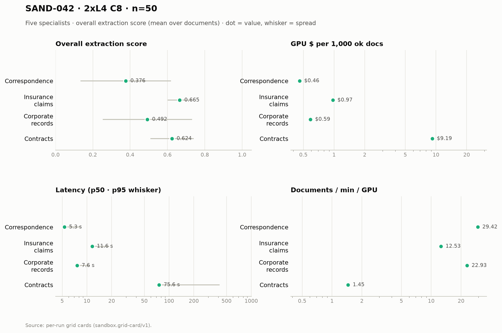

# SAND-042 · 2× L4 · client concurrency 8 (4 per replica) · n=50 × 5 specialists

**Cells reported:** 5 of 5 · **Runbook:** `sand42-2l4-c8` · **Model:** Qwen/Qwen3-8B-AWQ · L4 @ $0.80/GPU-hr

## Shared conditions

| Condition | Value |
| --- | --- |
| Engine | Qwen/Qwen3-8B-AWQ · max_model_len 32768 · max_num_seqs 16/replica · max_inputs 32 |
| Fleet | 2 replica(s) · client concurrency 8 (4 per replica) |
| Dataset | `Lucius-Morningstar/mailroom-dataset` ground_truth @ ed7576b6, split=all, seed 42, one class bucket, 50 per class stratified over every subclass (min 1 per sub-type) |
| Prompt | v1 `*_simplified` stems only |
| Output cap | max_tokens 8,192 · temperature 0.7 contracts + merger, 0.1 elsewhere |
| GPU telemetry | in-container nvidia-smi series, label `sand42-2l4-c8` |

## Per specialist

| Metric | Correspondence | Insurance Claims | Corporate Records | Contracts | Merger Agreements |
| --- | ---: | ---: | ---: | ---: | ---: |
| Quality (95% CI) | 0.376 [0.307, 0.444] | 0.665 [0.648, 0.683] | 0.492 [0.426, 0.558] | 0.624 [0.591, 0.657] | 0.028 [0.017, 0.041] |
| Scored documents | 50 | 50 | 50 | 50 | 50 |
| Quality SD | 0.242 | 0.064 | 0.239 | 0.116 | 0.043 |
| Scoring method | suite | suite | suite | suite+cuad | suite+maud |
| Clause metric | n/a (no clause scoring) | n/a (no clause scoring) | n/a (no clause scoring) | CUAD F1 0.637 · 50 labeled | MAUD acc 2.8% · 297/811 answered |
| Ok rate (Wilson) | 50/50 100.0% [0.929, 1.000] | 50/50 100.0% [0.929, 1.000] | 50/50 100.0% [0.929, 1.000] | 50/50 100.0% [0.929, 1.000] | 50/50 100.0% [0.929, 1.000] |
| Schema-valid rate | 100.0% | 28.0% | 96.0% | 100.0% | 100.0% |
| Parse errors | 0 | 0 | 0 | 0 | 0 |
| Length-capped | 0 | 0 | 0 | 0 | 0 |
| Error kinds | none | none | none | none | none |
| p50 latency (s) | 5.3 | 11.6 | 7.6 | 75.6 | 359.1 |
| p95 latency (s) | 8.3 | 18.7 | 10.8 | 413.2 | 783.9 |
| SLO (s) · met | 60 · yes | 60 · yes | 60 · yes | 300 · no | 1,800 · yes |
| Documents/min | 58.84 | 25.06 | 45.86 | 2.90 | 0.94 |
| Documents/min/GPU | 29.42 | 12.53 | 22.93 | 1.45 | 0.47 |
| Goodput docs/min/GPU | 29.42 | 12.53 | 22.93 | 0.00 | 0.47 |
| Tokens/s/GPU | 1,346.5 | 777.5 | 1,568.6 | 449.0 | 814.5 |
| Mean TTFT (s) | 0.55 | 0.62 | 0.80 | 1.64 | 3.33 |
| Prefix-cache hit | 61.7% | 57.0% | 49.7% | 37.0% | 17.6% |
| Wall (s) | 51.0 | 119.7 | 65.4 | 1,032.8 | 3,186.0 |
| Billed GPU $ (run) | $0.0229 | $0.0486 | $0.0293 | $0.4593 | $1.2841 |
| $ / 1k ok docs | $0.458920 | $0.972480 | $0.586840 | $9.185660 | $25.681540 |
| $ / 1k schema-valid | $0.458920 | $3.473143 | $0.611292 | $9.185660 | $25.681540 |
| $ / doc | $0.000459 | $0.000972 | $0.000587 | $0.009186 | $0.025682 |
| $ / ok doc | $0.000459 | $0.000972 | $0.000587 | $0.009186 | $0.025682 |
| $ / 1M tokens | $0.167 | $0.261 | $0.143 | $0.495 | $0.247 |
| GPU util (mean/p95/min–max) | 65.0% mean / 99.0 p95 / 0.0–100.0% min–max (n=15) | 85.6% mean / 100.0 p95 / 0.0–100.0% min–max (n=32) | 82.4% mean / 100.0 p95 / 0.0–100.0% min–max (n=19) | 84.7% mean / 100.0 p95 / 0.0–100.0% min–max (n=330) | 92.8% mean / 100.0 p95 / 0.0–100.0% min–max (n=913) |
| GPU mem used (mean) | 20,992 MiB (91.1% of 23,034) | 21,023 MiB (91.3% of 23,034) | 21,023 MiB (91.3% of 23,034) | 21,025 MiB (91.3% of 23,034) | 21,027 MiB (91.3% of 23,034) |
| GPU mem bandwidth (mean) | 57.8% mean | 83.0% mean | 76.2% mean | 80.1% mean | 80.7% mean |
| Sampling coverage | 100.0% | 94.7% | 100.0% | 98.9% | 99.0% |
| GPU power (W, mean) | 59.8 | 67.0 | 65.6 | 66.4 | 69.9 |
| GPU temp (C, mean) | 62.9 | 69.6 | 72.5 | 75.2 | 76.3 |
| KV cache use, mid-run (max %) | 2.8% | 7.9% | 10.2% | 29.4% | 51.1% |
| Queue depth, mid-run (running/waiting) | 4 running / 0 waiting | 4 running / 0 waiting | 5 running / 3 waiting | 7 running / 5 waiting | 8 running / 1 waiting |
| Preemptions | 0 | 0 | 0 | 0 | 0 |
| Length finishes | 0 | 0 | 0 | 5 | 12 |

## Figure

## Cost (computed from the session)

The fleet is pinned warm (`min_containers=1`) from deploy to teardown, so Modal meters the **whole window** — the cold boot and the idle between specialists included. This is computed from the session's own timestamps, not scraped from the billing CLI (whose figures are credits-based and workspace-wide).

| Fleet cost | Value |
| --- | ---: |
| Replicas × GPU | 2 × L4 @ $0.80/GPU-hr |
| Cold boot (deploy → ready) | 434.0 s |
| Fleet window (deploy → teardown) | 4,731.0 s |
| Fleet GPU-hours | 2.6283 |
| **Fleet GPU $** | **$2.1027** |
| Of which the five runs | 4,149.6 s (87.7%) |
| Boot + idle overhead | 581.4 s |

## Per-run cards

| Specialist | Run ID | Card |
| --- | --- | --- |
| Correspondence | `sand42-50-correspondence-specialist-awq-2l4-c8` | [sand42-50-correspondence-specialist-awq-2l4-c8.card.md](correspondence/sand42-50-correspondence-specialist-awq-2l4-c8.card.md) |
| Insurance Claims | `sand42-50-insurance-claims-specialist-awq-2l4-c8` | [sand42-50-insurance-claims-specialist-awq-2l4-c8.card.md](insurance_claims/sand42-50-insurance-claims-specialist-awq-2l4-c8.card.md) |
| Corporate Records | `sand42-50-corporate-records-specialist-awq-2l4-c8` | [sand42-50-corporate-records-specialist-awq-2l4-c8.card.md](corporate_records/sand42-50-corporate-records-specialist-awq-2l4-c8.card.md) |
| Contracts | `sand42-50-contracts-specialist-awq-2l4-c8` | [sand42-50-contracts-specialist-awq-2l4-c8.card.md](contracts/sand42-50-contracts-specialist-awq-2l4-c8.card.md) |
| Merger Agreements | `sand42-50-merger-specialist-awq-2l4-c8` | [sand42-50-merger-specialist-awq-2l4-c8.card.md](merger_agreement/sand42-50-merger-specialist-awq-2l4-c8.card.md) |

_Merger dominates pooled throughput (≈ 112k prompt tokens per agreement on the frozen settings), so no pooled column is reported here — compare per class._

_Generated 2026-10-13T04:33:13+00:00 by `sandbox run card --runbook sand42-2l4-c8` from the committed per-run `*.card.json`._
