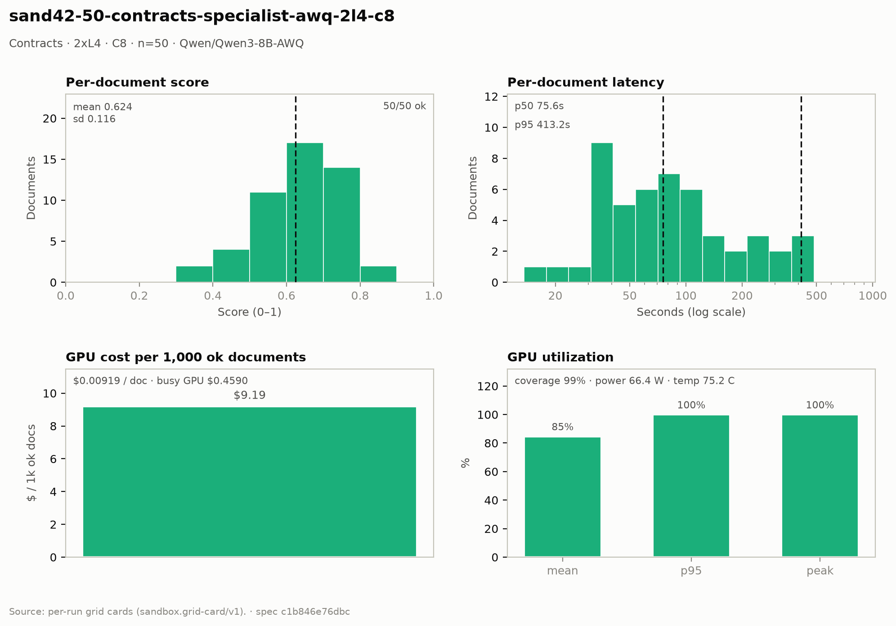

# Contracts — 2× L4 · C8 · n=50

**Run:** `sand42-50-contracts-specialist-awq-2l4-c8` · **Model:** Qwen/Qwen3-8B-AWQ · vLLM v0.29.0 · Modal `sandbox-vllm` · L4 @ $0.80/GPU-hr

## Conditions

| Condition | Value |
| --- | --- |
| Task | contracts_specialist |
| Prompt | contracts_specialist_v33_simplified |
| Temperature | 0.7 (posture knob) |
| Output cap (max_tokens) | 8,192 |
| Input cap (max_input_chars) | 49,000 |
| Chunk window (chars) | 43000 |
| Chunk overlap (chars) | 6000 |
| Job retries | 2 |
| Dataset | Lucius-Morningstar/mailroom-dataset ground_truth @ ed7576b6, split=all, seed 42 |
| Draw | 50 docs (fingerprint 5344b28a3033) |
| Engine | awq_marlin · fp8 KV · CUDA graphs [1, 2, 4, 8, 16] · prefix caching on · thinking off |
| Admission | max_model_len 32768 · max_num_seqs 16 per replica · max_inputs 32 |

## Score & cost card

| Metric | Value |
| --- | ---: |
| **Run** |  |
| Run ID | `sand42-50-contracts-specialist-awq-2l4-c8` |
| GPUs / replicas | 2 |
| Concurrency | 8 (4 per replica) |
| Documents | 50 |
| Spec hash | c1b846e7… |
| **Time** |  |
| Wall (busy) | 1,032.79 s |
| GPU seconds | 1,033.39 s |
| Cold boot | 0.33 s |
| **Cost** |  |
| Busy-window GPU $ | $0.459018 |
| Billed GPU $ | $0.459283 |
| Billed seconds | 1,033.39 s |
| Idle $ | $0.095599 (215.10 s) |
| Cost per document | $0.009186 |
| Cost per ok document | $0.009186 |
| Cost per 1M tokens | $0.4952 |
| **Tokens** |  |
| Prompt tokens | 800,404 |
| Completion tokens | 127,141 (13.7%) |
| Total tokens | 927,545 |
| Tokens per document | 18,551 |
| Per document: instructions + template | 3,353 (18.1%) |
| Per document: document text | 12,655 (68.2%) |
| Per document: output | 2,543 (13.7%) |
| Instruction tokens per model call | 1,884 over 89 calls |
| Token split basis | document chars ÷ 4.5 chars/token; instructions are the remainder |
| Completion p95 / max (ok docs) | 7,438 / 8,121 |
| **Throughput** |  |
| Tokens / second | 898.1 |
| Tokens / second per L4 | 449.0 |
| Documents / minute | 2.90 |
| **Latency (per document, ok rows)** |  |
| Mean | 130.83 s |
| p50 | 75.56 s |
| p95 | 413.19 s |
| Max | 840.16 s |
| **Engine (vLLM /metrics)** |  |
| Parallelism (Σ latency ÷ wall) | 6.33× of 8 |
| Slot occupancy | 79.2% |
| Coverage | replicas observed: 2 of 2 |
| Requests per replica (this run) | 48 / 41 |
| Mean TTFT per replica | 1.768 s / 1.505 s |
| Prefix-cache hit per replica | 39.0% / 34.9% |
| Preemptions per replica (this run) | 0 / 0 |
| Length-capped finishes per replica (this run) | 2 / 3 |
| **GPU hardware (nvidia-smi)** | 330 samples · serving-replica nvidia-smi |
| GPU utilization | 84.7 % mean (p95 100.0 / peak 100.0 / min 0.0) |
| Sampling coverage | 98.9 % |
| GPU power draw | 66.4 W (min 29.9 / max 73.6) of 72 W cap |
| GPU memory bandwidth | 80.1 % (min 0.0 / max 100.0) |
| GPU SM clock | 1,485 MHz (min 1,020 / max 2,040) |
| GPU temperature | 75.2 C (min 58.0 / max 80.0) |
| GPU memory used | 21,025 MiB (min 21,022 / max 21,028) |
| **Quality** |  |
| Overall extraction score | 0.6241 (sd 0.116) |
| Score min / max | 0.3590 / 0.8400 |
| Scoring method | `suite+cuad` |
| Schema-valid rate | 1.00 |
| Parse errors | 0 |
| Errors | 0 / 50 |
| **Clause scoring (CUAD)** |  |
| Docs with CUAD labels | 50 |
| Micro precision / recall / F1 | 0.650 / 0.623 / 0.637 |
| Metadata value checks | 81 / 142 |
| Suite field score (mean) | not captured |
| **Paired n** |  |
| Documents a paired delta can use | 50 of 50 |

## Figure

## Per-document results

| # | Document | OK | Score | Latency (s) | Prompt tok | Completion tok | Error |
| ---: | --- | --- | ---: | ---: | ---: | ---: | --- |
| 1 | `DOC-593f2c6de770b84c` | yes | 0.8182 | 39.1 | 9228 | 1435 | — |
| 2 | `DOC-e235bc9735f96335` | yes | 0.5306 | 53.2 | 10699 | 980 | — |
| 3 | `DOC-f5a54932794ef16e` | yes | 0.6667 | 58.9 | 5302 | 1076 | — |
| 4 | `DOC-385a86c69f8e562c` | yes | 0.5263 | 71.8 | 6560 | 1319 | — |
| 5 | `DOC-268df6c8fabb385a` | yes | 0.6667 | 39.3 | 5201 | 952 | — |
| 6 | `DOC-3c07c9ccd9a01d6e` | yes | 0.7200 | 114.2 | 7428 | 2425 | — |
| 7 | `DOC-a7ea445212692b88` | yes | 0.7333 | 76.3 | 9369 | 1864 | — |
| 8 | `DOC-eaa14fe106140524` | yes | 0.6250 | 48.8 | 7001 | 1341 | — |
| 9 | `DOC-4fb6419e37bff201` | yes | 0.6087 | 200.1 | 22234 | 4639 | — |
| 10 | `DOC-e4272758b561f8cd` | yes | 0.5556 | 95.3 | 6987 | 2296 | — |
| 11 | `DOC-1843cfdaf5db1840` | yes | 0.6000 | 20.9 | 7407 | 559 | — |
| 12 | `DOC-cbc1f0d62edbb23e` | yes | 0.5000 | 61.1 | 4155 | 1634 | — |
| 13 | `DOC-2c3a9c3168cd0e3a` | yes | 0.6667 | 37.5 | 3385 | 1261 | — |
| 14 | `DOC-73055dbb1e9f5f2f` | yes | 0.7273 | 196.3 | 49409 | 4771 | — |
| 15 | `DOC-f8b0d4bcbac60ca2` | yes | 0.6667 | 36.9 | 3824 | 934 | — |
| 16 | `DOC-81c4ce12d907380c` | yes | 0.5714 | 35.7 | 7047 | 935 | — |
| 17 | `DOC-0752e0811f5f5eb7` | yes | 0.3590 | 324.4 | 41619 | 8121 | — |
| 18 | `DOC-e29140d2e8e989be` | yes | 0.6275 | 328.9 | 45485 | 7891 | — |
| 19 | `DOC-b83763aeff114369` | yes | 0.7742 | 68.5 | 7446 | 2138 | — |
| 20 | `DOC-9cee2e10b449a71c` | yes | 0.7368 | 116.0 | 21752 | 2738 | — |
| 21 | `DOC-812192e392d8d410` | yes | 0.6000 | 95.7 | 5551 | 2858 | — |
| 22 | `DOC-9a36838df2878b37` | yes | 0.5455 | 70.8 | 8142 | 1606 | — |
| 23 | `DOC-2b510409d3b9a4a6` | yes | 0.6207 | 395.2 | 12036 | 2673 | — |
| 24 | `DOC-e998c563b82122b9` | yes | 0.5000 | 51.5 | 10006 | 1240 | — |
| 25 | `DOC-1e22a2d4068b8650` | yes | 0.7059 | 61.9 | 7587 | 1619 | — |
| 26 | `DOC-27b649fe2f6fae8e` | yes | 0.6667 | 50.5 | 5464 | 1180 | — |
| 27 | `DOC-70f90b46b2c4f1a6` | yes | 0.6667 | 13.6 | 3154 | 444 | — |
| 28 | `DOC-035731e655e67aab` | yes | 0.4706 | 120.4 | 5207 | 3045 | — |
| 29 | `DOC-1ddc9333769d27e4` | yes | 0.6154 | 35.7 | 4450 | 1061 | — |
| 30 | `DOC-dfb4e69a3ab10dc9` | yes | 0.5217 | 40.9 | 7378 | 1262 | — |
| 31 | `DOC-a6f559e4010fc8d1` | yes | 0.7742 | 478.4 | 31544 | 3727 | — |
| 32 | `DOC-8993ad1085e08bd0` | yes | 0.7429 | 143.7 | 22402 | 3411 | — |
| 33 | `DOC-712c3f92a0a56b77` | yes | 0.3846 | 235.6 | 56227 | 6288 | — |
| 34 | `DOC-d6b6b418dd211b76` | yes | 0.4167 | 23.6 | 7293 | 711 | — |
| 35 | `DOC-c9d4c4f8ff433527` | yes | 0.7500 | 35.0 | 7730 | 995 | — |
| 36 | `DOC-472f423cdf0819ef` | yes | 0.5714 | 74.8 | 4656 | 1777 | — |
| 37 | `DOC-fe06800cc62e5e19` | yes | 0.6250 | 79.8 | 8619 | 1861 | — |
| 38 | `DOC-8f737e9fec8f24f0` | yes | 0.7857 | 157.5 | 35815 | 3771 | — |
| 39 | `DOC-62b300182901e850` | yes | 0.6154 | 224.6 | 33346 | 5513 | — |
| 40 | `DOC-3f4003eb02433292` | yes | 0.7500 | 33.6 | 4421 | 849 | — |
| 41 | `DOC-e0d31c39359cb803` | yes | 0.5000 | 62.0 | 6879 | 1703 | — |
| 42 | `DOC-1266801f2faad19f` | yes | 0.7027 | 413.2 | 23527 | 2797 | — |
| 43 | `DOC-4b57f485708ab60b` | yes | 0.5455 | 91.0 | 6639 | 2002 | — |
| 44 | `DOC-e218d39bb2f3c5ef` | yes | 0.4000 | 92.5 | 19923 | 2690 | — |
| 45 | `DOC-dbe52fd78e44b0ef` | yes | 0.7500 | 85.3 | 18750 | 2068 | — |
| 46 | `DOC-01849fa3020a5ac1` | yes | 0.4444 | 33.1 | 4173 | 958 | — |
| 47 | `DOC-dfd20f94bb76b6e4` | yes | 0.6061 | 98.0 | 21000 | 2458 | — |
| 48 | `DOC-6b67382dcf833c5b` | yes | 0.7143 | 135.9 | 24554 | 3676 | — |
| 49 | `DOC-aca7df716d7eef00` | yes | 0.8400 | 244.3 | 36448 | 6151 | — |
| 50 | `DOC-53e364f030a30b5c` | yes | 0.6923 | 840.2 | 75945 | 7438 | — |

_Generated 2026-10-13T04:32:54+00:00 by `sandbox run card`. Machine-readable twin: `sand42-50-contracts-specialist-awq-2l4-c8.card.json`._
