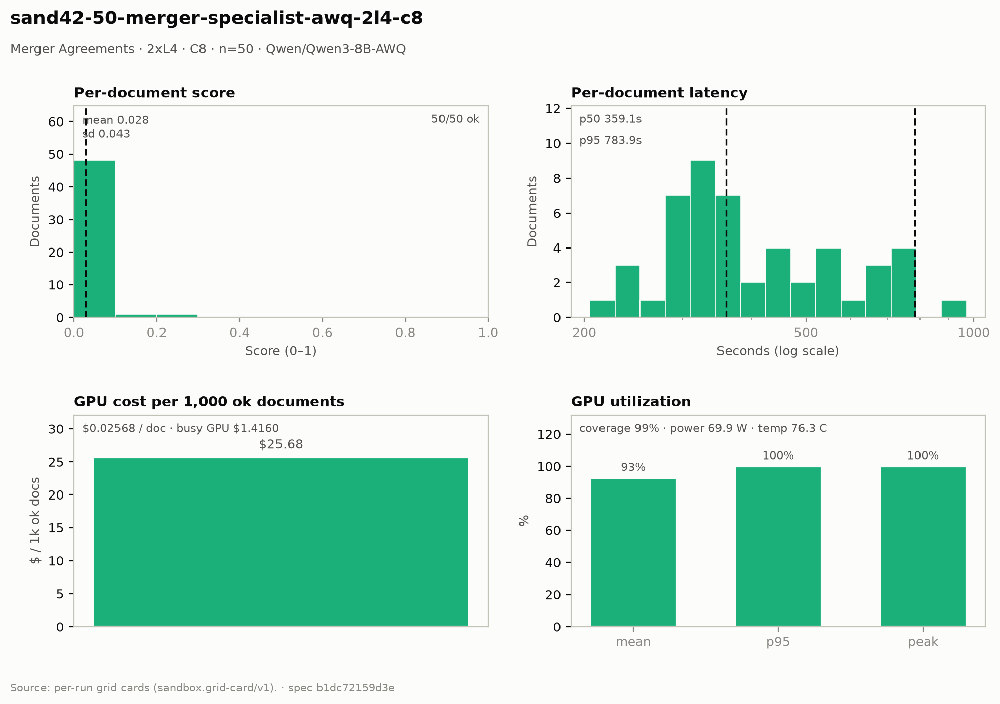

# Merger Agreements — 2× L4 · C8 · n=50

**Run:** `sand42-50-merger-specialist-awq-2l4-c8` · **Model:** Qwen/Qwen3-8B-AWQ · vLLM v0.29.0 · Modal `sandbox-vllm` · L4 @ $0.80/GPU-hr

## Conditions

| Condition | Value |
| --- | --- |
| Task | merger_agreement_specialist |
| Prompt | merger_agreement_specialist_simplified |
| Temperature | 0.7 (posture knob) |
| Output cap (max_tokens) | 6,144 |
| Input cap (max_input_chars) | 54,000 |
| top_p | 0.8 |
| top_k | 20 |
| presence_penalty | 1.0 |
| Length re-samples | 1 |
| Chunk window (chars) | 47000 |
| Chunk overlap (chars) | 6500 |
| Job retries | 2 |
| Dataset | Lucius-Morningstar/mailroom-dataset ground_truth @ ed7576b6, split=all, seed 42 |
| Draw | 50 docs (fingerprint aa4e596805e7) |
| Engine | awq_marlin · fp8 KV · CUDA graphs [1, 2, 4, 8, 16] · prefix caching on · thinking off |
| Admission | max_model_len 32768 · max_num_seqs 16 per replica · max_inputs 32 |

## Score & cost card

| Metric | Value |
| --- | ---: |
| **Run** |  |
| Run ID | `sand42-50-merger-specialist-awq-2l4-c8` |
| GPUs / replicas | 2 |
| Concurrency | 8 (4 per replica) |
| Documents | 50 |
| Spec hash | b1dc7215… |
| **Time** |  |
| Wall (busy) | 3,185.97 s |
| GPU seconds | 2,889.17 s |
| Cold boot | 0.37 s |
| **Cost** |  |
| Busy-window GPU $ | $1.415988 |
| Billed GPU $ | $1.284077 |
| Billed seconds | 2,889.17 s |
| Idle $ | $0.224321 (504.72 s) |
| Cost per document | $0.025682 |
| Cost per ok document | $0.025682 |
| Cost per 1M tokens | $0.2474 |
| **Tokens** |  |
| Prompt tokens | 4,867,606 |
| Completion tokens | 322,630 (6.2%) |
| Total tokens | 5,190,236 |
| Tokens per document | 103,805 |
| Per document: instructions + template | 6,178 (6.0%) |
| Per document: document text | 91,174 (87.8%) |
| Per document: output | 6,453 (6.2%) |
| Instruction tokens per model call | 750 over 412 calls |
| Token split basis | document chars ÷ 4.5 chars/token; instructions are the remainder |
| Completion p95 / max (ok docs) | 10,273 / 12,061 |
| **Throughput** |  |
| Tokens / second | 1,629.1 |
| Tokens / second per L4 | 814.5 |
| Documents / minute | 0.94 |
| **Latency (per document, ok rows)** |  |
| Mean | 429.00 s |
| p50 | 359.11 s |
| p95 | 783.86 s |
| Max | 970.46 s |
| **Engine (vLLM /metrics)** |  |
| Parallelism (Σ latency ÷ wall) | 6.73× of 8 |
| Slot occupancy | 84.2% |
| Coverage | replicas observed: 2 of 2 |
| Requests per replica (this run) | 231 / 191 |
| Mean TTFT per replica | 3.524 s / 3.144 s |
| Prefix-cache hit per replica | 17.6% / 17.6% |
| Preemptions per replica (this run) | 0 / 0 |
| Length-capped finishes per replica (this run) | 6 / 6 |
| **GPU hardware (nvidia-smi)** | 913 samples · serving-replica nvidia-smi |
| GPU utilization | 92.8 % mean (p95 100.0 / peak 100.0 / min 0.0) |
| Sampling coverage | 99.0 % |
| GPU power draw | 69.9 W (min 31.7 / max 75.0) of 72 W cap |
| GPU memory bandwidth | 80.7 % (min 0.0 / max 100.0) |
| GPU SM clock | 1,400 MHz (min 930 / max 2,040) |
| GPU temperature | 76.3 C (min 70.0 / max 83.0) |
| GPU memory used | 21,027 MiB (min 21,024 / max 21,028) |
| **Quality** |  |
| Overall extraction score | 0.0285 (sd 0.043) |
| Score min / max | 0.0000 / 0.2308 |
| Scoring method | `suite+maud` |
| Schema-valid rate | 1.00 |
| Parse errors | 0 |
| Errors | 0 / 50 |
| **Clause scoring (MAUD)** |  |
| Questions answered / labeled | 297 / 811 (36.6%) |
| Micro accuracy | 2.8% |
| Precision on answered | 7.7% |
| Clean subset | 18 / 343 |
| Suite field score (mean) | not captured |
| **Paired n** |  |
| Documents a paired delta can use | 50 of 50 |

## Figure

## Per-document results

| # | Document | OK | Score | Latency (s) | Prompt tok | Completion tok | Error |
| ---: | --- | --- | ---: | ---: | ---: | ---: | --- |
| 1 | `DOC-d4b1a7a2b981fbf4` | yes | 0.0000 | 295.3 | 81817 | 4545 | — |
| 2 | `DOC-26933c93d649fa3f` | yes | 0.0625 | 322.4 | 96354 | 4739 | — |
| 3 | `DOC-c96b9c7e12f91576` | yes | 0.0000 | 333.6 | 92490 | 6619 | — |
| 4 | `DOC-5f5d40f6b2c338ac` | yes | 0.0000 | 338.8 | 109887 | 4772 | — |
| 5 | `DOC-0a733ab86f2390ae` | yes | 0.0000 | 358.1 | 81545 | 6125 | — |
| 6 | `DOC-45f801408be08af6` | yes | 0.0000 | 427.4 | 109920 | 6249 | — |
| 7 | `DOC-4f45bef14dcd1dbf` | yes | 0.0625 | 246.0 | 70774 | 3906 | — |
| 8 | `DOC-eb2b56fe30dc35f4` | yes | 0.1176 | 628.0 | 85298 | 4482 | — |
| 9 | `DOC-9420b777a4b0784c` | yes | 0.0000 | 360.6 | 98627 | 6158 | — |
| 10 | `DOC-e8538f75b0f993e6` | yes | 0.0000 | 329.0 | 113280 | 6573 | — |
| 11 | `DOC-b03c0d2bbbb9659e` | yes | 0.0556 | 501.6 | 113393 | 8326 | — |
| 12 | `DOC-882fabf7aba36941` | yes | 0.0000 | 282.2 | 92325 | 5553 | — |
| 13 | `DOC-511062d64bc9afc6` | yes | 0.0000 | 291.9 | 97584 | 4639 | — |
| 14 | `DOC-dc7f18df501aec90` | yes | 0.0667 | 970.5 | 83008 | 3969 | — |
| 15 | `DOC-52f9a5be69429299` | yes | 0.0000 | 657.7 | 103918 | 10606 | — |
| 16 | `DOC-30eda1e78a5f6fb5` | yes | 0.0000 | 430.5 | 107499 | 8083 | — |
| 17 | `DOC-71bc59dd305ee8ed` | yes | 0.2308 | 767.1 | 109675 | 6673 | — |
| 18 | `DOC-f90cc5fb2ceac154` | yes | 0.0000 | 308.3 | 93747 | 5227 | — |
| 19 | `DOC-ab5578f1f9f04244` | yes | 0.0000 | 439.1 | 132059 | 7877 | — |
| 20 | `DOC-1e016055aa435e71` | yes | 0.0000 | 334.4 | 109137 | 5155 | — |
| 21 | `DOC-63beb09b179ea4ee` | yes | 0.0588 | 302.4 | 83572 | 6319 | — |
| 22 | `DOC-bec74557186e9409` | yes | 0.0000 | 366.0 | 78918 | 6147 | — |
| 23 | `DOC-fe9a8b51344d67d9` | yes | 0.0000 | 340.1 | 130099 | 6329 | — |
| 24 | `DOC-5f8ef95caa2fd349` | yes | 0.0000 | 576.5 | 104105 | 8739 | — |
| 25 | `DOC-2b9f668ab6cb8901` | yes | 0.0526 | 323.7 | 90831 | 5243 | — |
| 26 | `DOC-0534799ed39ca0db` | yes | 0.0556 | 401.3 | 92828 | 6511 | — |
| 27 | `DOC-7e2818ceb0167d5a` | yes | 0.0556 | 204.6 | 78432 | 4327 | — |
| 28 | `DOC-37bc3c44ae2c4ef6` | yes | 0.0000 | 478.4 | 90012 | 7749 | — |
| 29 | `DOC-72b0b8c8385edd48` | yes | 0.0556 | 275.9 | 84431 | 5479 | — |
| 30 | `DOC-26fa94f698c37fc5` | yes | 0.0588 | 228.9 | 79931 | 4257 | — |
| 31 | `DOC-297745a521cd1e8c` | yes | 0.0000 | 547.3 | 103150 | 10273 | — |
| 32 | `DOC-c6b5f7ea5f718c28` | yes | 0.0588 | 552.9 | 82765 | 4430 | — |
| 33 | `DOC-03712a2b0a99a314` | yes | 0.0588 | 437.0 | 119367 | 7899 | — |
| 34 | `DOC-0070a4e34dddbfd5` | yes | 0.0588 | 311.7 | 85209 | 5373 | — |
| 35 | `DOC-ac48214468deb8dd` | yes | 0.0588 | 304.1 | 72887 | 5627 | — |
| 36 | `DOC-9d34581755c603a3` | yes | 0.0000 | 251.5 | 94942 | 4483 | — |
| 37 | `DOC-386ac6d669b7731c` | yes | 0.0769 | 783.9 | 93831 | 8246 | — |
| 38 | `DOC-e6c8852b877c4598` | yes | 0.0000 | 414.3 | 104093 | 7128 | — |
| 39 | `DOC-1cd38a83b224335d` | yes | 0.0588 | 213.3 | 78294 | 3584 | — |
| 40 | `DOC-f9870e3b8fd141b0` | yes | 0.0000 | 687.6 | 134889 | 7509 | — |
| 41 | `DOC-169bbcdc5d9e609c` | yes | 0.0000 | 356.9 | 134911 | 6060 | — |
| 42 | `DOC-fcaddb5bdc94ce63` | yes | 0.0000 | 702.4 | 82656 | 6424 | — |
| 43 | `DOC-f449b47c7269f288` | yes | 0.0625 | 299.8 | 95394 | 5384 | — |
| 44 | `DOC-f09307ad314d386f` | yes | 0.0000 | 359.9 | 103329 | 6709 | — |
| 45 | `DOC-5d30efc302f3c431` | yes | 0.0000 | 521.5 | 130943 | 9344 | — |
| 46 | `DOC-ff3ceb691481f1bd` | yes | 0.0000 | 333.7 | 91432 | 6132 | — |
| 47 | `DOC-681bc6115b882191` | yes | 0.0000 | 358.3 | 120554 | 6773 | — |
| 48 | `DOC-23f224263f6974c5` | yes | 0.0000 | 360.5 | 83736 | 8100 | — |
| 49 | `DOC-b3d0149fd994357a` | yes | 0.0588 | 747.2 | 78500 | 9715 | — |
| 50 | `DOC-ab735131c00271bc` | yes | 0.0000 | 786.1 | 81228 | 12061 | — |

_Generated 2026-10-13T04:32:59+00:00 by `sandbox run card`. Machine-readable twin: `sand42-50-merger-specialist-awq-2l4-c8.card.json`._
